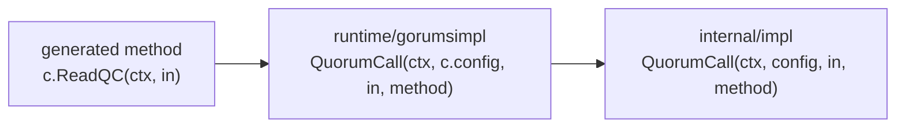
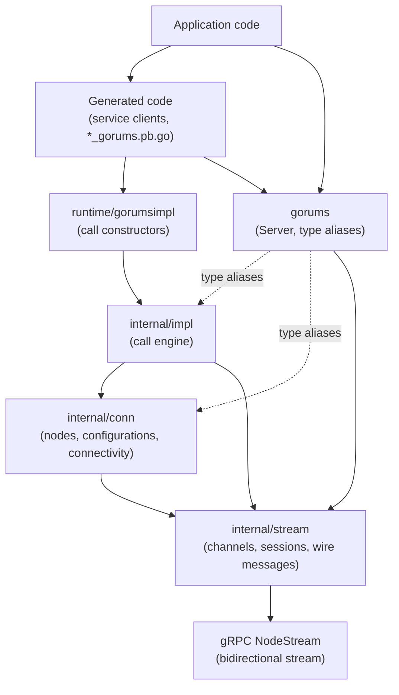
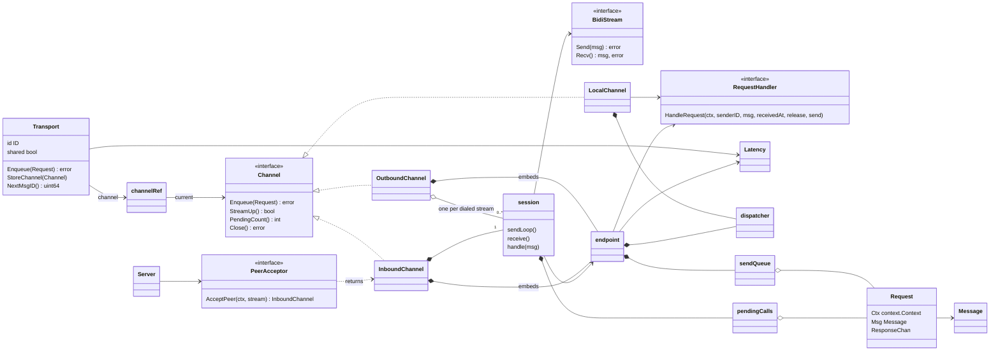
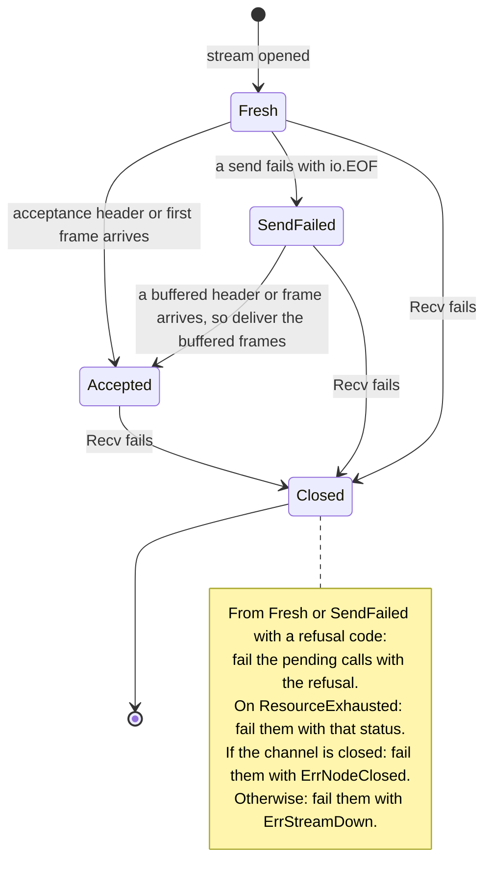
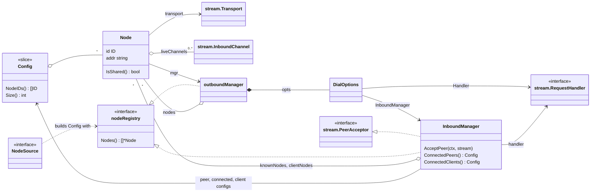
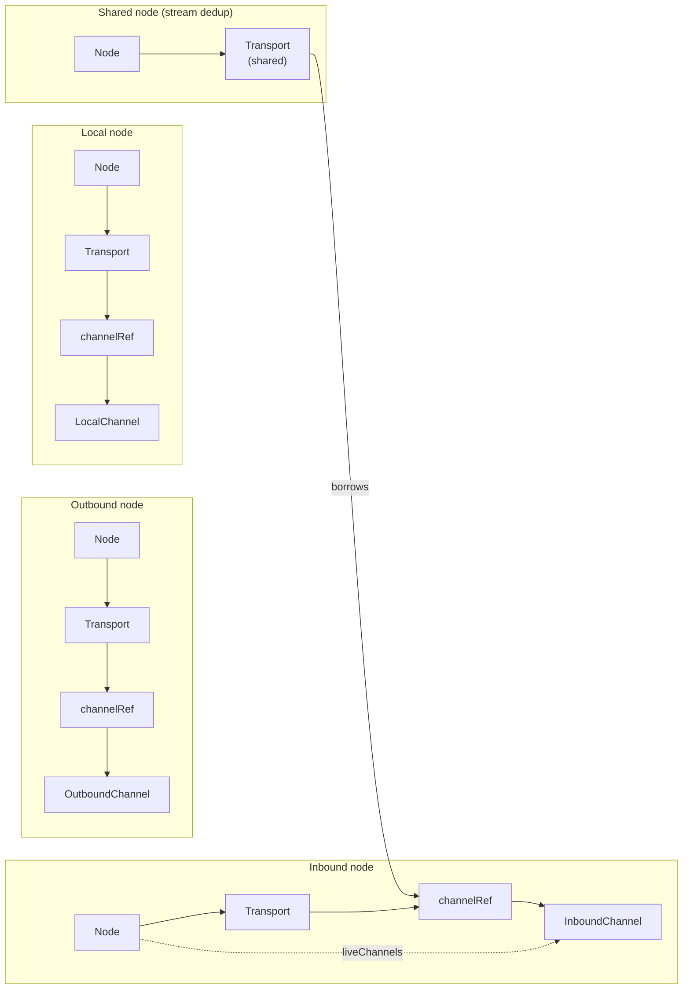
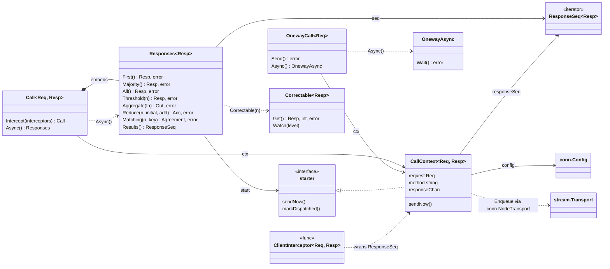
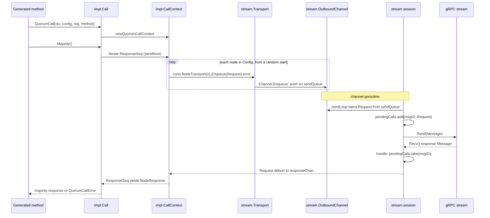
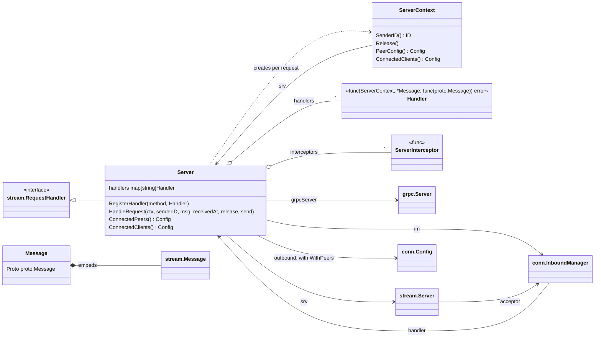
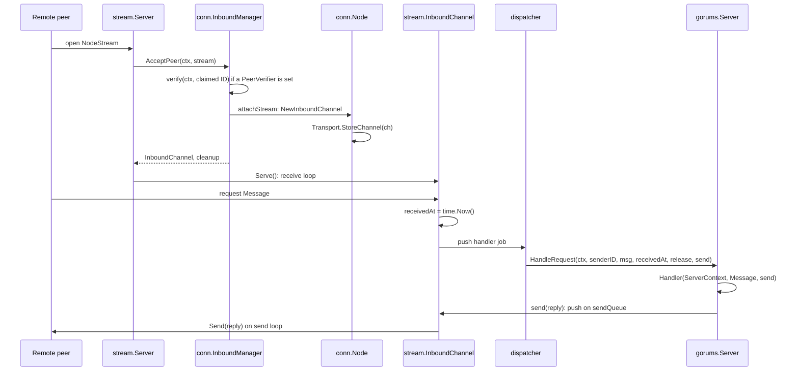

# Developer Guide

The repository contains two main components located in `cmd/protoc-gen-gorums`:

* **dev:** Contains static code and code generated by templates.
* **gengorums:** Contains the code for the `protoc-gen-gorums` compiler, as well as templates.

## Workflow and File Endings

1. **Template Changes:** Changes to generated code in the `dev/zorums_*_gorums.pb.go` files should be done by editing the various templates in the corresponding `gengorums/template_*.go` file.
   Making changes to the `zorums*` files will be overwritten.
   Note that there is not a one-to-one correspondence for all files.

2. **Static Code File Changes:** Any `.go` file in `dev/` whose name does not start with `zorums` and does not end in `_test.go` is treated as static code and bundled into `template_static.go`.
   Currently, `aliases.go` holds the only static declarations, but additional files can be added to the `dev/` directory and they will be included automatically.

### Generated Static Code and Reserved Identifiers

The generator writes the static code of the `dev/` package verbatim into one file per Go package, named `gorums.pb.go`.
Every `protoc` run that generates Gorums code for a Go package writes this file.
The generator reports an error if protoc-gen-go writes a file with the same path for a `.proto` file of the package, such as `gorums.proto` in the same directory.
It goes in the output directory of the first file of the package that the run generates Gorums code for, in `protoc`'s file order.
The path is `path.Dir(prefix) + "/gorums.pb.go"`, where `prefix` is that file's `GeneratedFilenamePrefix`, so the output options of `protoc`, such as `paths=source_relative` and `module=`, apply to it.
The content depends only on the Go package name and the versions of `protoc-gen-gorums` and `protoc`.
Thus, separate runs for the files of one Go package write the same file.
The `_gorums.pb.go` files hold no static code.
In dev mode, the generator writes no `gorums.pb.go` file, because `dev/aliases.go` declares the static code.
The static code currently consists of four type aliases from `dev/aliases.go`:

```go
type (
    Config                = gorums.Config
    ID                    = gorums.ID
    Node                  = gorums.Node
    Correctable[Resp any] = gorums.Correctable[Resp]
)
```

These aliases make the most commonly used Gorums types available as `pb.Config`, `pb.ID`, `*pb.Node`, and `*pb.Correctable[*pb.X]`.
Application code and the generated clients use them.
The generated client constructors take a `Config` or a `*Node`, and the client structs hold these values.
Thus, a `_gorums.pb.go` file depends on the aliases in the `gorums.pb.go` file of its package.
The other generated code refers to the `gorums` types directly, such as `*gorums.Call` and `*gorums.OnewayCall`.

Because the static code appears once per Go package, it may declare package-level names.
Each exported package-level name of the static code becomes a **reserved identifier**.
The bundler (`gengorums/bundle.go`) discovers these names by inspecting `TypesInfo.Defs` for all exported, package-scope declarations in the dev package.
Thus, declaring an exported top-level name in `aliases.go` is sufficient to reserve that name.
The Gorums generator rejects a proto file whose messages, enums, enum values, or oneof wrappers use a reserved identifier as their Go name.
Such a name collides with the generated alias.
The check includes nested messages and enums, and every file of the Go package.
For a oneof wrapper, the check tests both the name of the open API and the name of the opaque API, which starts with a lowercase letter.
`goPackage.checkReservedIdents` in `gengorums/package.go` runs the check, and `shouldGenerate` in `gengorums/generate.go` calls it for each file with Gorums methods.
RPC methods are methods of the generated client interfaces, so they do not collide with the aliases; [Generated Client Interfaces](#generated-client-interfaces) describes the name checks for the generated client and server names.

The `.proto` files of a Go package may be compiled in one `protoc` run or in separate runs.
Separate runs write the same `gorums.pb.go`, so the static code is declared once.
The `_gorums.pb.go` files declare only the names of their own services.

The `TestBundleReservedIdentifiers` test in `gengorums/bundle_test.go` pins the expected set.
If you add or remove a static declaration, update that test to match.

The `static` recipe of the `Justfile` runs the bundler; `just dev` and `just genproto` run it first.
The recipe copies `template_static.go` to `template_static.go.bak`.
It then runs `protoc-gen-gorums --bundle=<file>`, which calls `GenerateBundleFile` in `gengorums/bundle.go`.
The bundler loads the static files of `dev/` and writes three variables into `template_static.go`:

* `staticCode` holds the text of the static declarations, without the package and import clauses.
* `reservedIdents` holds the reserved identifiers.
* `pkgIdentMap` maps the import path of each package that the static code uses to one exported identifier of that package.

`generatePackageFile` in `gengorums/generate.go` writes `staticCode` into `gorums.pb.go`.
It then qualifies each identifier of `pkgIdentMap`, so the file gets the imports that the static code needs.
If the bundle changes, the bundler prints the diff for inspection and a command to revert the change.

### Generated Client Interfaces

A Go package may hold several services, in one `.proto` file or in several.
For each service `S`, the generator emits up to two client interfaces, as gRPC does.
The call type of each RPC method decides which client the method belongs to:

| Client        | Constructor                              | Implementing struct | Call types             |
| ------------- | ---------------------------------------- | ------------------- | ---------------------- |
| `SClient`     | `NewSClient(config Config) SClient`      | `sClient`           | quorum call, multicast |
| `SNodeClient` | `NewSNodeClient(node *Node) SNodeClient` | `sNodeClient`       | remote call, unicast   |

A service with only one kind of call gets only that client.
The struct name is an unexported variant of the interface name.
`sClient` holds a `Config`, and `sNodeClient` holds a `*Node`.
`Config` and `Node` are the package's own aliases from `gorums.pb.go`.
The structs have value receivers.
The clients have no helper methods.

Every method has the same shape `(ctx, in)`, and calls one runtime constructor:

| Call type                            | Result               | Runtime constructor                                      |
| ------------------------------------ | -------------------- | -------------------------------------------------------- |
| quorum call                          | `*gorums.Call`       | `gorumsimpl.QuorumCall(ctx, c.config, in, method)`       |
| quorum call with a `stream` response | `*gorums.Call`       | `gorumsimpl.QuorumCallStream(ctx, c.config, in, method)` |
| multicast                            | `*gorums.OnewayCall` | `gorumsimpl.Multicast(ctx, c.config, in, method)`        |
| remote call                          | `(*Out, error)`      | `gorumsimpl.RemoteCall(ctx, c.node, in, method)`         |
| unicast                              | `*gorums.OnewayCall` | `gorumsimpl.Unicast(ctx, c.node, in, method)`            |

A quorum call or multicast with the `gorums.scatter` option also gets a method `MScatter(ctx, in []*In)`.
The template that generates `M` generates `MScatter` too, so the call types need no scatter variants.
`MScatter` has the result of `M` and calls the scatter constructor with the RPC name of `M`:

| Call type                            | Runtime constructor of `MScatter`                               |
| ------------------------------------ | --------------------------------------------------------------- |
| quorum call                          | `gorumsimpl.QuorumCallScatter(ctx, c.config, in, method)`       |
| quorum call with a `stream` response | `gorumsimpl.QuorumCallStreamScatter(ctx, c.config, in, method)` |
| multicast                            | `gorumsimpl.MulticastScatter(ctx, c.config, in, method)`        |



A method signature is written once, for both the interface and the struct.
godoc shows the doc comments of the interface methods.

The server interface `SServer` and the function `RegisterSServer` come from `gengorums/template_server.go`.

In dev mode, the generator writes one `dev/zorums_{name}_gorums.pb.go` file for the client interfaces, for the server interface, and for each entry of `gorumsCallTypesInfo` in `gengorums/calltype.go`:

| Dev file                         | Template                 | Contents                                       |
| -------------------------------- | ------------------------ | ---------------------------------------------- |
| `zorums_client_gorums.pb.go`     | `template_client.go`     | client interfaces, constructors, and structs   |
| `zorums_quorumcall_gorums.pb.go` | `template_quorumcall.go` | quorum call and streaming quorum call methods  |
| `zorums_multicast_gorums.pb.go`  | `template_multicast.go`  | multicast methods                              |
| `zorums_remotecall_gorums.pb.go` | `template_remotecall.go` | remote call methods                            |
| `zorums_unicast_gorums.pb.go`    | `template_unicast.go`    | unicast methods                                |
| `zorums_server_gorums.pb.go`     | `template_server.go`     | server interface and handler registration      |

The client file holds the interface declarations of all call types.
Each call type file holds the implementing methods of that call type.

Outside dev mode, all of this code goes into a single `_gorums.pb.go` file, and the static code goes into the package's `gorums.pb.go` file.

### Running the Generator

Any change to templates or static code requires `just genproto` in order to:

* Bundle the static code into `template_static.go`.
* Rebuild the `protoc-gen-gorums` compiler.
* Regenerate every generated file in the repository, including the `zorums_*_gorums.pb.go` files.

`just dev` bundles the static code and updates only the `zorums_*_gorums.pb.go` files.
The `Justfile` runs `protoc-gen-gorums`, `protoc-gen-go`, and `protoc-gen-go-grpc` with `go tool`.
The versions that `go.mod` pins are used, and `go tool` rebuilds the plugin from this tree when its sources change.
No generator needs to be installed, and no `go install` changes `PATH`.

A compile error in a generated `zorums*` file does not stop the bundler.
The bundler reads the static files only.
`just dev` can regenerate the generated files after such an error.
A compile error in a static file still stops the bundle.
The bundle is the text of those files, so they have to compile.

The recipes regenerate their files every time; there is no timestamp check.
Run `just check-generated` to regenerate everything and fail if a generated file changes.
CI runs it.
See the `Justfile` for more details.

## Testing

Testing the `protoc-gen-gorums` compiler itself can be done by running the command below.
These tests verify that the code generated by the Gorums compiler is correct and stable.

### Default Mode (bufconn)

By default, tests use in-memory bufconn connections:

```sh
just test
```

### Integration Mode (real network)

For end-to-end validation with real TCP connections:

```sh
just integrationtest
```

Or directly:

```sh
go test -tags=integration ./...
```

### Property Tests and Fuzzing

Runtime property tests use `pgregory.net/rapid` with standard test assertions.
They compare bounded inputs and operation sequences with independent models.
The default `go test` run executes 100 cases per property and the native fuzz seed corpora.

Run more cases with fresh inputs:

```sh
just propertytest 1000
```

Name Rapid tests with the suffix `Properties` so `just propertytest` runs them.
Add any new package that contains property tests to the package list in that recipe.

Rapid prints a seed and writes a minimized failure under the package's `testdata/rapid` directory.
Reproduce a failure with the printed `-rapid.seed` or `-rapid.failfile` command, and keep useful minimized cases as regressions.
Use `-count=1` for extended runs so Go's test cache does not reuse an earlier successful run.
The `*rapid.T` context and cleanups belong to the generated case, including shrink attempts.
It is not interchangeable with the `testing.TB` accepted by `gorumstest`; the current properties use in-process data structures without server setup.

Run each native fuzz target for 30 seconds with two workers:

```sh
just fuzztest 30
```

Add new fuzz targets to the `fuzztest` recipe so the scheduled workflow runs them.

Run a single target for a longer campaign:

```sh
go test ./internal/impl -run='^$' -fuzz='^FuzzMarshaling$' -fuzztime=5m -parallel=2
```

The targets cover method/payload decoding, message metadata, peer identities, node-ID metadata, tree option boundaries, and quorum terminal properties through `rapid.MakeFuzz`.
Native fuzz failures are saved under the package's `testdata/fuzz` directory and run during ordinary tests.
Keep the registry and each fuzz invocation isolated: inputs must not register global protobuf descriptors or depend on earlier cases.

Queue blocking tests use `testing/synctest`.
Dispatcher, Correctable, and configuration watcher properties use `rapid.SyncTest` to give each generated case its own bubble while preserving Rapid's failure shrinking.
Explicit gates and fake time control event order; these tests complement race detection rather than enumerating goroutine schedules.
The models distinguish successful-response counts from distinct-node counts, lazy pending-call sweeping from immediate cancellation, and handler release from handler return.

PR CI runs the runtime race tests.
The Property and Fuzz Tests workflow runs weekly and on manual dispatch; it preserves failure corpora and logs as artifacts.
Session/reconnect models, stream replacement tests, generated-descriptor fuzzing, benchkit properties, and TCP fault injection remain separate work.

### Generator Tests

The tests in `internal/testprotos` run `protoc-gen-go` and `protoc-gen-gorums` in process, through the `internal/gentest` harness.
They test the generator in this tree, not a `protoc-gen-gorums` binary installed on `PATH`, so they need no generator build.
Only parsing uses `protoc`.
The tests write nothing into the tree: `gentest.Compile` type-checks the generated code from memory.

| Test                                   | Checks                                                                           |
| -------------------------------------- | -------------------------------------------------------------------------------- |
| `TestFailingProtoFiles`                | Proto files written inline in the test fail with the expected generator error.   |
| `TestFailingProtoFilesPackageFile`     | A proto file whose `.pb.go` path is the package's `gorums.pb.go` path fails.     |
| `TestGenerateProtoFiles`               | The code generated for each fixture under `internal/testprotos` compiles.        |
| `TestGenerateImportedPackageNames`     | Generated code compiles with message packages named `c`, `ctx`, `in`, or `node`. |
| `TestGoldenProtoFiles`                 | The Gorums code for each fixture equals its golden file in `testdata`.           |
| `TestGeneratePackageFiles`             | Several files of one Go package compile, with one `gorums.pb.go` per package.    |
| `TestGeneratePackageFilesSeparateRuns` | Separate runs for one Go package write the same `gorums.pb.go` and compile.      |
| `TestStabilityZorums`                  | Two runs on `dev/zorums.proto` produce identical output.                         |
| `TestStabilityDevFilesUpToDate`        | The committed `dev/zorums*.pb.go` files equal the output of the generator.       |

To add a failing case, add a table entry to `TestFailingProtoFiles`.
To add a fixture, add a `.proto` file in a new directory under `internal/testprotos`, with a `go_package` that matches the directory, and create its golden files as shown below.
Each fixture directory with Gorums output has two golden files: `X_gorums.pb.go.golden` and `gorums.pb.go.golden`.

After an intended change to a template, refresh the golden files and the dev files, and review both diffs:

```sh
just golden
just dev
```

Golden files replace the tool versions in the header with `VERSION`, so a release or a new `protoc` does not change them.

## Error Strings

An error string describes the operation that was attempted, not the failure.
Wrapped errors then read like prose: `dialing node 3: creating stream: connection refused`.

* Do not start an error with `failed to`, `could not`, `unable to`, or `error`.
  Write `creating node %d: %w`, not `failed to create node %d: %w`.
* An error that wraps nothing names the condition: `no nodes in configuration`.
* A precondition has the form `cannot X without Y`.
* Do not add an annotation that only says something failed; return the error unchanged.
* Use a lowercase first letter, no trailing punctuation, and no newlines.
  Sentinel errors (`ErrXxx`) name the condition.
* Only the layer that creates a Gorums error adds the `gorums: ` prefix.
  A caller that wraps such an error does not add it again.
* Messages that an application end user reads directly, such as `protoc-gen-gorums` and command-line diagnostics, may keep explicit failure wording.

`TestErrorStringsDescribeOperation` in `internal/lint` rejects the banned prefixes in `errors.New` and `fmt.Errorf` calls.

## Benchmarking

See [benchmarking.md](./benchmarking.md)

## Justfile

The repository root holds one [`Justfile`](../Justfile) for all three modules.
Install [`just`](https://github.com/casey/just) to run it.
Run `just` to list the recipes with their descriptions.
The `Justfile` itself also serves as documentation; inspect it for details.

Recipes that need an external program, such as `buf`, `golangci-lint`, and `gopls`, report a missing program before they run anything.
These three are written in Go, but they are not tools in `go.mod`: each would add a large number of dependencies to the module.
Install them separately; the workflows pin their versions.
The programs that `go.mod` pins as tools, such as the generators, `deadcode`, and `modernize`, need no installation, because `go tool` runs them.

Recipes are grouped as `generate`, `build`, `examples`, `test`, and `lint`; a recipe without a group, `all`, comes first.
`just genproto` regenerates all generated code, `just test` runs the tests, and `just lint` runs the linters.

## Releasing

Releases are made with the `gorums-release` program in `internal/cmd/gorums-release`.
The [release guide](./release-guide.md) describes how to install and use it.

## Runtime Architecture

The runtime is split into layers, each in its own package.
The diagrams below show the main types of each layer and how they connect.
They omit helper types and most fields and methods; the package doc comments and the source are authoritative.

### Package Layering

Generated code reaches the call engine through `runtime/gorumsimpl`, and application code uses the types that the root `gorums` package re-exports as aliases.
Each internal package depends only on the packages below it.



### Stream Layer (`internal/stream`)

A `Transport` is everything a call needs to reach one node.
It holds a `channelRef`, an atomically replaceable reference to the node's current `Channel`.
There are three channel kinds:

* `OutboundChannel` runs over streams this node dials; it opens a new `session` for each stream and fails the stream's pending calls with `ErrStreamDown` when the stream is lost.
  A stream that the server refuses is not lost: it ends with a refusal code (`Unauthenticated`, `PermissionDenied`, `InvalidArgument`, or `Unimplemented`) before the server accepted it.
  Its pending two-way and streaming calls fail with the refusal, as does a one-way call whose send fails on it.
  The channel then backs off before it opens the next stream, failing requests at once with the refusal until then.
  A stream that cannot be opened because of a refusal code is handled the same way, for example when the connection failed the dial-side identity check.
  A stream opened after a refusal is suspect for health reporting: its sends do not clear `LastErr` until the server accepts it.
  The channel sends on a new stream at once, but the stream counts as up only once the server accepts it: when the `gorums-accepted` response header or the first frame arrives.
  The receive goroutine of each session waits for the response headers before it starts receiving.
  A refused stream ends without the `gorums-accepted` header, although a server interceptor may have sent other headers.
  Only the channel's live session can bring the stream up, so a late acceptance of a session that a GOAWAY replaced has no effect.
* `InboundChannel` runs over one `InboundStream` that the server accepted; its single `session` ends with the stream.
  An `InboundStream` is a `BidiStream` that can also send response headers, as a server stream can and a client stream cannot.
  Its send loop first sends the `gorums-accepted` header, before any message.
  A stream sends its response headers only once, so the header fails if a gRPC stream interceptor on the server has already sent them.
  The send loop then sends an empty acceptance frame instead.
  Message IDs start at 1, so the dialer drops that frame after it counts it as the server's first frame.
* `LocalChannel` serves requests in-process through the handler, with no stream.

The two stream channels embed an `endpoint` with the send queue, the request dispatcher, the optional `RequestHandler`, and the `Latency` estimate.
A `session` sends queued requests on its `BidiStream`, records two-way calls in `pendingCalls`, and routes received frames either to a pending call or to the dispatcher.
The dispatcher runs handlers one at a time, in arrival order.
A handler that returns without calling `Release` hands its goroutine to the next queued handler, so a busy stream keeps one goroutine and the stack it has grown; an early `Release` starts the next handler on a new goroutine.
On the server side, `Server.NodeStream` asks a `PeerAcceptor` for the `InboundChannel` of each accepted stream.
The stream layer does not check identities; the connection layer below does.

Each inbound stream has its own dispatcher, so the order contract is FIFO within one stream.
A new stream is an ordering boundary: the dispatchers of a sender's older and newer streams run independently, so their handlers may overlap, and a request from the older stream may start after a request from the newer one.
An outbound channel sends each call at most once, so no call crosses the boundary twice.
The TLA+ model in `spec/stream` checks the contract (`just tlc ContractFIFO`) and shows the boundary (`just tlc LimitCrossStreamFIFO`, `just tlc LimitCrossStreamOverlap`).



Only the receive loop of an outbound session learns whether the server refused its stream: when the server ends a stream, a concurrent `Send` returns `io.EOF`, and only `Recv` returns the server's status.
So a send that fails with `io.EOF` before the server accepted the stream only cancels the stream, and the receive loop disposes of the pending calls.
The session's `handoff` state ensures that exactly one goroutine disposes of them.
The session's `verdict` channel closes when the server accepts the stream or receiving ends; the run loop waits for it after a session ends, and then reads whether the server refused the stream.
A one-way send that fails this way also waits for the verdict, so that it fails with the refusal too.
If the acceptance header or a frame arrives after the failed send, the stream was accepted: receiving delivers the frames that the stream buffered, and fails the calls still pending when `Recv` fails.



### Connectivity Layer (`internal/conn`)

A `Config` is a slice of `*Node`, and each `Node` has a fixed `stream.Transport`.
An `outboundManager` creates and owns the nodes of the configurations built by `NewConfig` and `Config.Extend`.
`NewConfig` returns the manager's `Close` method as the close function; `Config` has no `Close` method, so only the creator of a pool can close it.
The manager's `Close` closes all its nodes and logs any node's close error, since a caller cannot act on it.
`Config.Extend` fails on a closed manager before it builds any node.
A closed manager also rejects new nodes under the same lock that guards its node list, so a node that races with `Close` cannot outlive it.
A server's `InboundManager` owns the nodes for its known peers and for the peer-capable clients that connect to it, and maintains the connected-peer and connected-client configurations.
It implements `stream.PeerAcceptor`, attaching each accepted stream to the matching node.
If a `PeerVerifier` is set, `InboundManager` checks each claimed peer ID.
It refuses unknown IDs.
For a known ID, it attaches the stream only after verification succeeds.
The outbound manager uses the same verifier for the configured peers that it dials.
It wraps the node's transport credentials in `verifiedCredentials`, which run the verifier right after each TLS handshake, with the handshake's `AuthInfo` in the context.
A failed check closes the connection before it carries any stream.
The handshake error carries `codes.Unauthenticated`, and gRPC passes that code on to the stream that the `OutboundChannel` tries to open.
The channel treats it as a refusal and waits before it opens the next stream.
gRPC's own connection backoff, which `WithBackoff` sets, decides when the next handshake runs.
A node with a verifier needs transport credentials for `verifiedCredentials` to wrap.
`WithTransportCredentials` sets them in `DialOptions.Credentials`.
Both managers implement `nodeRegistry`, which a `NodeSource` uses to build a configuration.
`WithNodes` captures each node's address and optional `TLSIdentity` together.
When a server uses that source through `WithPeers`, `conn.NewPeerVerifier` validates the identity set and creates the internal TLS verifier.
`nodeMap.newConfig` also builds a verifier and passes it to `nodeRegistry.newNode`, so `NewConfig` and `Config.Extend` check the servers they dial.
The `InboundManager` ignores that verifier and uses its own for its known peers.
Address-only sources yield no verifier, while mixed, empty, invalid, or duplicate identities are configuration errors.



### Node Kinds

A node's kind is set by the transport and channel it is created with.
Calls only ever see the node's transport; the channel behind the transport's `channelRef` may change as streams come and go.

* An outbound node dials its peer and owns an `OutboundChannel`.
* A local node is the server's own node in its peer configuration; it owns a `LocalChannel` that calls the server's handler in-process.
* An inbound node is a known peer or a client of the server; `InboundManager.AcceptPeer` stores an `InboundChannel` in its transport when the peer's stream arrives, and clears it when the last live stream ends.
* A shared node is the higher-ID peer's outbound node under stream deduplication; its shared transport borrows the inbound peer node's `channelRef`, `Latency`, and message-ID generator.



### Call Engine (`internal/impl`)

A call constructor takes the call's `context.Context` and its target directly: a `Config` for quorum calls and multicasts, and a `*Node` for remote calls and unicasts.
On an empty `Config`, the `CallContext` holds `ErrEmptyConfig`: a quorum call sends nothing, its terminal methods return the error, and its response iterator yields one response that holds the error; `Multicast` returns a `OnewayCall` that sends nothing and returns the error from `Send` and `Wait`.
A scatter call whose request count differs from the size of its `Config` is handled the same way, with `ErrScatterCount`.
On a nil `*Node`, `RemoteCall` returns `ErrNoNode`, and `Unicast` returns a `OnewayCall` whose `CallContext` holds `ErrNoNode` and that sends nothing.
A quorum call constructor builds a `CallContext` that holds the request, the target `Config`, the response channel, and the response iterator (`ResponseSeq`).
A scatter constructor builds the same `CallContext` with one request per node instead of one request: `requests[i]` goes to `Config[i]`, and `CallContext.Request` returns the zero value.
`Multicast` and `Unicast` build a `CallContext` that holds the request and the target `Config`, but no response iterator.
A unicast's `CallContext` holds a one-node `Config`.
A one-way `CallContext` gets a response channel only when `Async` dispatches the call; it carries the local send confirmations of the accepted requests.
The fan-out of a `CallContext` attempts every destination and returns the admission failures; a transport reports a rejection only to its caller.
`Send` returns the admission failures at once.
`Async` keeps them in the `OnewayAsync` handle, and `Wait` adds the stream-write errors.
A two-way call forwards them to its response channel.
`Send` checks the caller's context only before dispatch.
It queues its requests with a context that cannot be canceled, so an accepted request stays queued when the caller's context ends.
`RemoteCall` builds no `CallContext`; it enqueues one request on the node's transport and waits for the response.
A quorum call returns a `Call`, which embeds `Responses` and its terminal methods (`First`, `Majority`, `All`, `Threshold`, `Aggregate`, `Reduce`, `Matching`), as well as the `Correctable` future.
`Call.Async` sends the requests at once and returns the dispatched `Responses`, so any terminal method collects the replies later.
A one-way call (`Multicast`, `Unicast`) returns a `OnewayCall`, whose `Send` returns queue-admission errors and whose `Async` returns a `OnewayAsync` that collects admission failures and stream-write errors through `Wait`.
A `ClientInterceptor` wraps the response iterator before the call is dispatched.
A `MapRequest` interceptor sets one request per node when it is attached; scatter calls use the same per-node path.
`CallContext` reaches each node's send path through `conn.NodeTransport`.



### Quorum Call Path

A quorum call is dispatched lazily, on the first iteration of its response iterator, so that interceptors can be registered first.
Each node's channel sends on its own goroutine, and responses are matched to pending calls by message ID.
The fan-out starts at a random node of the configuration and wraps around, so no node is always enqueued last.
With a fixed order, the last node would wait longest on every call, and its measured latency would be higher than that of the other nodes.
Each node still receives a caller's requests in call order.



### Server Side (`gorums`)

The root `gorums.Server` ties the layers together on the server side.
It registers a `stream.Server` with its gRPC server, uses its `conn.InboundManager` as the server's `stream.PeerAcceptor`, and serves as the `stream.RequestHandler` for inbound streams, for its local node, and for back-channel requests on its outbound peer configuration.
`Server.HandleRequest` creates a `ServerContext` per request, records the sender ID that the channel passes in, and runs the registered `Handler`, wrapped by any `ServerInterceptor`s.
A `gorums.Message` wraps a request's `stream.Message` together with its decoded proto payload.
A handler delivers every response through its `send func(proto.Message)` callback:

* A unary handler calls `send` once.
* A streaming handler calls `send` once for each response.
* A one-way handler never calls `send`, and the server sends no response.

A handler either sends its responses or returns an error.
If it returns an error before it calls `send`, the caller receives the error as the call's reply.
`Server.HandleRequest` discards an error returned after `send`, so a unary call never gets two replies.
It logs the discarded error as a programming error, with the logger from `WithServerLogger`.
This matters most for the local node, which delivers its replies directly to the call: a second reply would take the place of another node's reply.
`Server.HandleRequest` builds the response envelope for each sent response and for a returned error, so handlers never touch envelopes.



### Inbound Request Path

Requests that arrive on one stream run through the handler one at a time until the handler calls `ServerContext.Release` or returns.
A handler's reply is queued on the stream's own channel and sent by its send loop.



## Stream Deduplication Internals

Symmetric stream deduplication makes the lower-ID peer of each pair the only dialer.
The higher-ID peer's outbound node is born shared: it borrows the matching inbound transport when the configuration is created, before the peer has connected.
The borrower cannot dial through a shared transport, so its calls fail with `gorums.ErrStreamDown` while the dialer's stream is unavailable; callers match it with `errors.Is`.
The dialer re-establishes a lost stream eagerly with capped backoff from its channel's goroutine, independently of its own sends.

Client-initiated message IDs use the low 63 bits, while server-initiated and shared-call IDs have bit 63 set.
A session uses this bit to route each received frame.
A frame in the peer's ID space is a request for the handler.
A frame in the session's own ID space is a response to one of its pending calls.
If no call is pending for it, the session drops the frame.
An error frame that no caller observes is counted in `unmatchedErrors` and logged if the channel has a logger: one with no pending call, since a server replies with an error to a one-way call that names an unknown method or cannot be decoded, and one for a call whose context has ended, even before a sweep removes the call.
An inbound channel borrowed by the peer configuration inherits that configuration's logger when the stream is attached, including after reconnection.
A shared call travels on the stream that the lower-ID peer dialed, as a server-initiated request.
So it takes its ID from the generator of the inbound peer node, which sets bit 63, and the dialer's session passes it to the handler.
The dialer's own calls on that stream keep their client-initiated IDs, so the calls of the two peers never collide on one stream.
These IDs encode as ten-byte protobuf varints because the high bit is set; the small wire-cost increase is intentional and avoids a second stream.

Each `session` owns the `pendingCalls` of its stream, so ending a session affects only the calls sent on that stream.
When a session ends, its pending calls fail, since the server may have handled them; a channel sends each call at most once.
The pending calls of an inbound session fail with `ErrStreamDown`.
The pending calls of an outbound session fail with the first error in this list that applies:

1. The server refused the stream: the calls fail with the status that the server ended the stream with.
2. The stream ended due to resource exhaustion: the calls fail with the stream's `ResourceExhausted` status.
3. The channel is closed: the calls fail with `ErrNodeClosed`.
4. Otherwise, the calls fail with `ErrStreamDown`.

A request that the send loop took from the queue but did not send goes first on the channel's next session.
These include the calls of a shared node that borrows the inbound stream.
Closing a channel ends its sessions and fails the requests in its send queue.

`Node` identity and its transport are fixed at construction; only the channel behind the transport's `channelRef` changes as streams come and go.
A call therefore reads the node's message-ID generator and current channel directly from that fixed transport, with no per-call binding step.

Every session handles a received request the same way, on inbound and outbound streams alike.
It appends the message's metadata to the incoming context and pushes the handler call to the endpoint's `dispatcher`, which runs handlers one at a time, in arrival order.
So a back-channel request on a stream that this node dialed is served like a request on an inbound stream.
