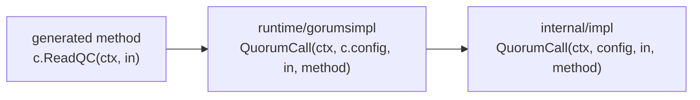
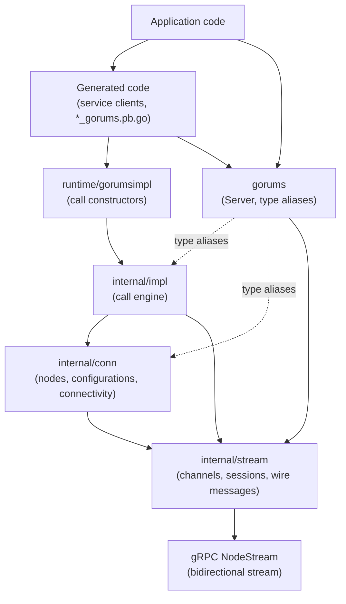
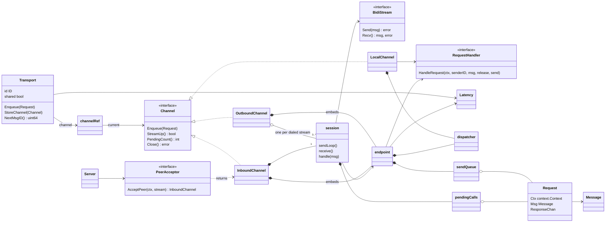
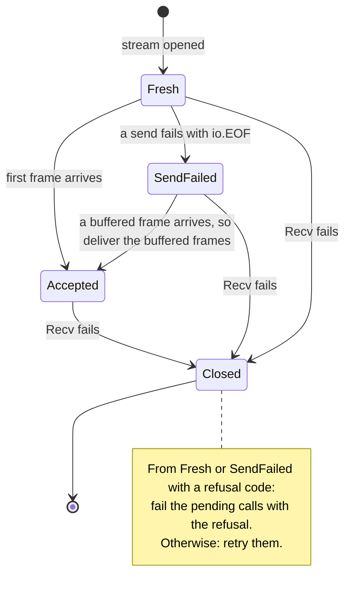
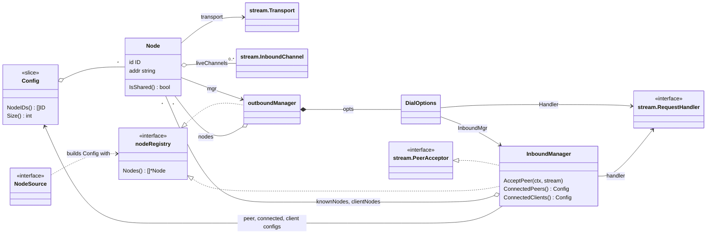
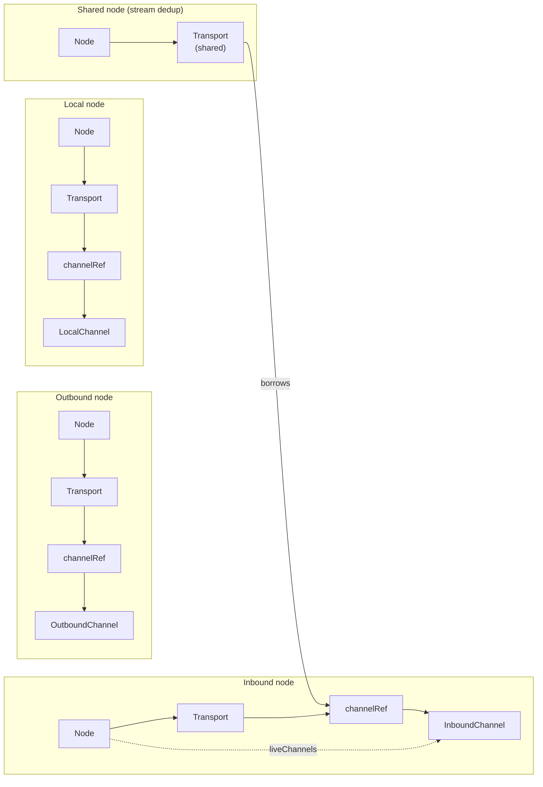
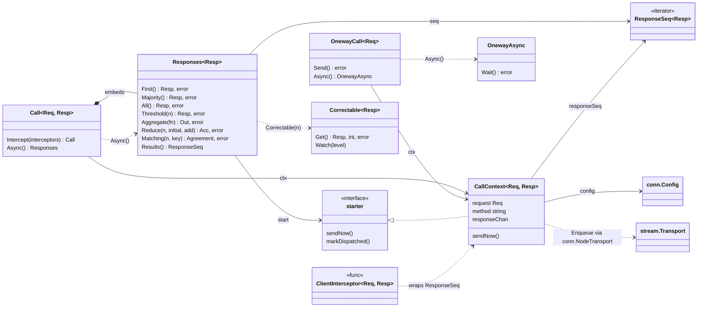
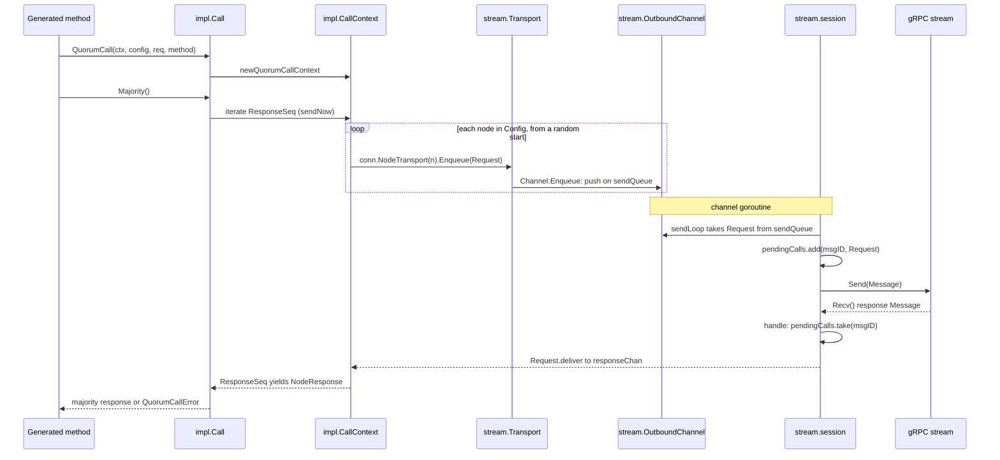
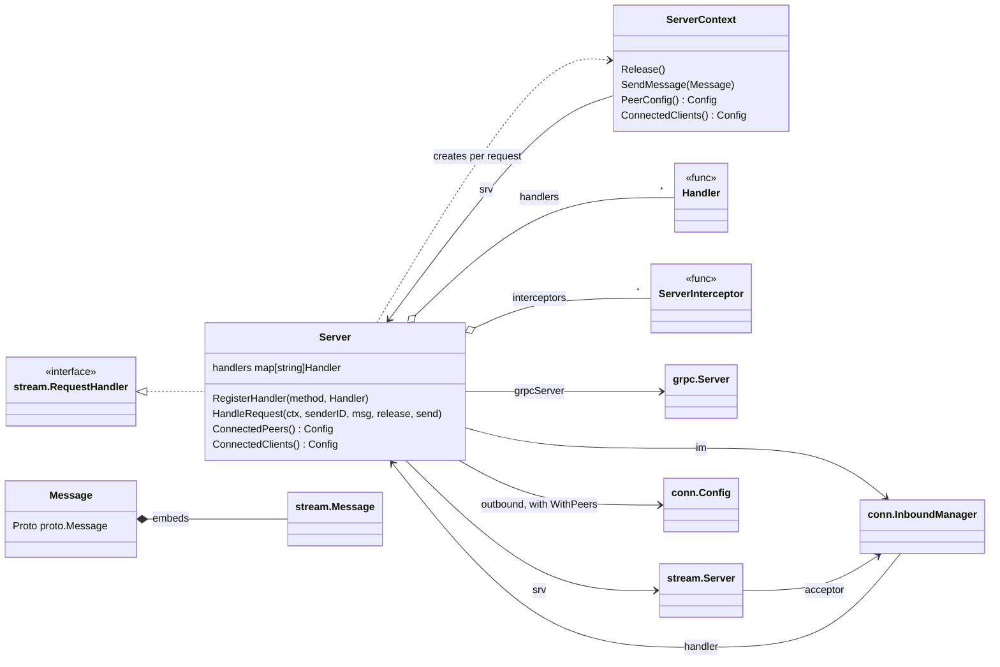
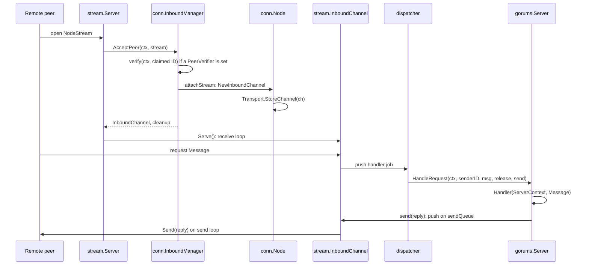

# Developer Guide

The repository contains two main components located in `cmd/protoc-gen-gorums`:

* **dev:** Contains static code and code generated by templates.
  In other words, this is the code that the `protoc-gen-gorums` compiler will output.
  All files that are not prefixed by `zorums*` and do not end in `_test.go` get bundled into `template_static.go`.
* **gengorums:** Contains the code for the `protoc-gen-gorums` compiler, as well as templates.

## Workflow and File Endings

1. **Template Changes:** Changes to generated code in the `dev/zorums_*_gorums.pb.go` files should be done by editing the various templates in the corresponding `gengorums/template_*.go` file.
   Making changes to the `zorums*` files will be overwritten.
   Note that there is not a one-to-one correspondence for all files.

2. **Static Code File Changes:** Any `.go` file in `dev/` that is not prefixed by `zorums_` and does not end in `_test.go` is treated as static code and bundled into `template_static.go`.
   Currently, `aliases.go` holds the only static declarations, but additional files can be added to the `dev/` directory and they will be included automatically.

### Generated Static Code and Reserved Identifiers

The generator writes the static code of the `dev/` package verbatim into one file per Go package, named `gorums.pb.go`.
Every `protoc` run that generates Gorums code for a Go package writes this file.
The generator reports an error if protoc-gen-go writes a file with the same path for a `.proto` file of the package, such as `gorums.proto` in the same directory.
It goes in the output directory of the first file of the package that the run generates Gorums code for, in `protoc`'s file order.
The path is `path.Dir(prefix) + "/gorums.pb.go"`, where `prefix` is that file's `GeneratedFilenamePrefix`, so the output options of `protoc`, such as `paths=source_relative` and `module=`, apply to it.
The content depends only on the Go package name and the versions of `protoc-gen-gorums` and `protoc`.
Thus, separate runs for the files of one Go package write the same file.
The `_gorums.pb.go` files hold no static code.
In dev mode, the generator writes no `gorums.pb.go` file, because `dev/aliases.go` declares the static code.
The static code currently consists of three type aliases from `dev/aliases.go`:

```go
type (
    Config = gorums.Config
    ID     = gorums.ID
    Node   = gorums.Node
)
```

These aliases make the most commonly used Gorums types available as `pb.Config`, `pb.ID`, and `*pb.Node`.
They exist for application code; the generated code itself refers to the `gorums` types, such as `gorums.Config` and `*gorums.Node`.

The `types` template (`gengorums/template_datatypes.go`) declares the alias `CorrectableX` for each response type `X` of a quorum call.
Several services and files of a Go package may return the same `X`.
Thus, the generator declares each such alias once per Go package.
The alias goes in the generated file of the first `.proto` file, in `protoc`'s file order, whose quorum calls return `X`.
In that order, imported files come first.
The generator picks this owner among all files of the `protoc` request, including the files that are only imports of the run (`Generate` is false).
If the owner is only an import, the run skips the alias; the run that generates the owner declares it.
Only a method with the `gorums.quorumcall` option produces an alias, so the owner always has a Gorums run.

Because the static code appears once per Go package, it may declare package-level names.
Each exported package-level name of the static code becomes a **reserved identifier**.
The bundler (`gengorums/bundle.go`) discovers these names by inspecting `TypesInfo.Defs` for all exported, package-scope declarations in the dev package.
Thus, declaring an exported top-level name in `aliases.go` is sufficient to reserve that name.
The Gorums generator rejects a proto file whose messages, enums, or enum values use a reserved identifier as their Go name.
Such a name collides with the generated alias.
The check includes nested messages and enums, and every file of the Go package.
RPC methods are methods of the generated client interfaces, so they do not collide with the aliases; [Generated Client Interfaces](#generated-client-interfaces) describes the name checks for the generated client and server names.

The `.proto` files of a Go package may be compiled in one `protoc` run or in separate runs.
Separate runs write the same `gorums.pb.go`, so the static code is declared once.
Only the `Correctable` aliases need care.
If `b.proto` imports `a.proto` from the same Go package, the run for `b.proto` sees `a.proto` as an import.
That run skips the `Correctable` aliases that `a.proto` owns, because the run for `a.proto` declares them.
If neither file imports the other, directly or indirectly, each run declares the `Correctable` aliases of its own quorum calls.
Thus, two such files must not both produce the same `CorrectableX` alias in separate runs.

The `TestBundleReservedIdentifiers` test in `gengorums/bundle_test.go` pins the expected set.
If you add or remove a static declaration, update that test to match.

### Generated Client Interfaces

A Go package may hold several services, in one `.proto` file or in several.
For each service `S`, the generator emits up to two client interfaces, as gRPC does.
The call type of each RPC method decides which client the method belongs to:

| Client        | Constructor                                     | Implementing struct | Call types             |
| ------------- | ----------------------------------------------- | ------------------- | ---------------------- |
| `SClient`     | `NewSClient(config gorums.Config) SClient`      | `sClient`           | quorum call, multicast |
| `SNodeClient` | `NewSNodeClient(node *gorums.Node) SNodeClient` | `sNodeClient`       | remote call, unicast   |

A service with only one kind of call gets only that client.
The struct name is an unexported variant of the interface name.
`sClient` holds a `gorums.Config`, and `sNodeClient` holds a `*gorums.Node`.
The structs have value receivers.
The clients have no helper methods.

Every method has the same shape `(ctx, in)`, and calls one runtime constructor:

| Call type                            | Result               | Runtime constructor                                      |
| ------------------------------------ | -------------------- | -------------------------------------------------------- |
| quorum call                          | `*gorums.Call`       | `gorumsimpl.QuorumCall(ctx, c.config, in, method)`       |
| quorum call with a `stream` response | `*gorums.Call`       | `gorumsimpl.QuorumCallStream(ctx, c.config, in, method)` |
| multicast                            | `*gorums.OnewayCall` | `gorumsimpl.Multicast(ctx, c.config, in, method)`        |
| remote call                          | `(*Out, error)`      | `gorumsimpl.RemoteCall(ctx, c.node, in, method)`         |
| unicast                              | `*gorums.OnewayCall` | `gorumsimpl.Unicast(ctx, c.node, in, method)`            |



A method signature is written once, for both the interface and the struct.
godoc shows the doc comments of the interface methods.

The server interface `SServer` and the function `RegisterSServer` come from `gengorums/template_server.go`.

In dev mode, the generator writes one `dev/zorums_{name}_gorums.pb.go` file for each entry of `gorumsCallTypesInfo` in `gengorums/generate.go`:

| Dev file                         | Template                 | Contents                                       |
| -------------------------------- | ------------------------ | ---------------------------------------------- |
| `zorums_types_gorums.pb.go`      | `template_datatypes.go`  | `Correctable` type aliases                     |
| `zorums_client_gorums.pb.go`     | `template_client.go`     | client interfaces, constructors, and structs   |
| `zorums_quorumcall_gorums.pb.go` | `template_quorumcall.go` | quorum call and streaming quorum call methods  |
| `zorums_multicast_gorums.pb.go`  | `template_multicast.go`  | multicast methods                              |
| `zorums_remotecall_gorums.pb.go` | `template_rpc.go`        | remote call methods                            |
| `zorums_unicast_gorums.pb.go`    | `template_unicast.go`    | unicast methods                                |
| `zorums_server_gorums.pb.go`     | `template_server.go`     | server interface and handler registration      |

The client file holds the interface declarations of all call types.
Each call type file holds the implementing methods of that call type.

Outside dev mode, all of this code goes into a single `_gorums.pb.go` file, and the static code goes into the package's `gorums.pb.go` file.

### Running the Generator

Any changes to templates or static code requires the invocation of `make` in order to:

* Bundle the static code into `template_static.go`.
* Rebuild the `protoc-gen-gorums` compiler.
* Update the `zorums_*_gorums.pb.go` files.

A compile error in a generated `zorums*` file does not stop the bundler.
The bundler reads the static files only.
`make dev` can regenerate the generated files after such an error.
A compile error in a static file still stops the bundle.
The bundle is the text of those files, so they have to compile.

See the `Makefile` for more details.
To force compile, e.g. following a `protoc` update, you can use:

```sh
make -B
```

## Testing

Testing the `protoc-gen-gorums` compiler itself can be done by running the command below.
These tests verify that the code generated by the Gorums compiler is correct and stable.

### Default Mode (bufconn)

By default, tests use in-memory bufconn connections:

```sh
make test
```

### Integration Mode (real network)

For end-to-end validation with real TCP connections:

```sh
make integrationtest
```

Or directly:

```sh
go test -tags=integration ./...
```

### Generator Tests

The tests in `internal/testprotos` run `protoc-gen-go` and `protoc-gen-gorums` in process, through the `internal/gentest` harness.
They test the generator in this tree, not a `protoc-gen-gorums` binary installed on `PATH`, so they need no `make installgorums`.
Only parsing uses `protoc`.
The tests write nothing into the tree: `gentest.Compile` type-checks the generated code from memory.

| Test                                   | Checks                                                                           |
| -------------------------------------- | -------------------------------------------------------------------------------- |
| `TestFailingProtoFiles`                | Proto files written inline in the test fail with the expected generator error.   |
| `TestGenerateProtoFiles`               | The code generated for each fixture under `internal/testprotos` compiles.        |
| `TestGenerateImportedPackageNames`     | Generated code compiles with message packages named `c`, `ctx`, `in`, or `node`. |
| `TestGoldenProtoFiles`                 | The Gorums code for each fixture equals its golden file in `testdata`.           |
| `TestGeneratePackageFiles`             | Several files of one Go package compile, with one `gorums.pb.go` per package.    |
| `TestGeneratePackageFilesSeparateRuns` | Separate runs for one Go package write the same `gorums.pb.go` and compile.      |
| `TestStabilityZorums`                  | Two runs on `dev/zorums.proto` produce identical output.                         |
| `TestStabilityDevFilesUpToDate`        | The committed `dev/zorums*.pb.go` files equal the output of the generator.       |

To add a failing case, add a table entry to `TestFailingProtoFiles`.
To add a fixture, add a `.proto` file in a new directory under `internal/testprotos`, with a `go_package` that matches the directory, and create its golden files as shown below.
Each fixture directory with Gorums output has two golden files: `X_gorums.pb.go.golden` and `gorums.pb.go.golden`.

After an intended change to a template, refresh the golden files and the dev files, and review both diffs:

```sh
make golden
make dev
```

Golden files replace the tool versions in the header with `VERSION`, so a release or a new `protoc` does not change them.

## Error Strings

An error string describes the operation that was attempted, not the failure.
Wrapped errors then read like prose: `dialing node 3: creating stream: connection refused`.

- Do not start an error with `failed to`, `could not`, `unable to`, or `error`.
  Write `creating node %d: %w`, not `failed to create node %d: %w`.
- An error that wraps nothing names the condition: `no nodes in configuration`.
- A precondition has the form `cannot X without Y`.
- Do not add an annotation that only says something failed; return the error unchanged.
- Use a lowercase first letter, no trailing punctuation, and no newlines.
  Sentinel errors (`ErrXxx`) name the condition.
- Only the layer that creates a Gorums error adds the `gorums: ` prefix.
  A caller that wraps such an error does not add it again.
- Messages that an application end user reads directly, such as `protoc-gen-gorums` and command-line diagnostics, may keep explicit failure wording.

`TestErrorStringsDescribeOperation` in `internal/lint` rejects the banned prefixes in `errors.New` and `fmt.Errorf` calls.

## Benchmarking

See [benchmarking.md](./benchmarking.md)

## Makefile

Below is a description of the current `Makefile` targets.
The `Makefile` itself also serves as documentation; inspect it for details.

| Target            | Description                                                                                            |
| ----------------- | ------------------------------------------------------------------------------------------------------ |
| `all`             | Builds `dev`, `benchmark`, and compiles tests (default target).                                        |
| `dev`             | Updates `template_static.go` and regenerates generated files from templates.                           |
| `genproto`        | Force-regenerates all protobuf and Gorums files across the repo (dev, benchmark, tests, examples).     |
| `benchmark`       | Compiles the benchmark tool.                                                                           |
| `compiletests`    | Compiles test protos in `internal/tests`.                                                              |
| `tools`           | Installs required tools (`protoc-gen-go`, `protoc-gen-go-grpc`, `stress`, etc.) via `go install tool`. |
| `installgorums`   | Reinstalls the `protoc-gen-gorums` plugin.                                                             |
| `bootstrapgorums` | Bootstraps the plugin when it is not yet installed.                                                    |
| `test`            | Runs all tests (using bufconn by default).                                                             |
| `integrationtest` | Runs integration tests with real TCP connections.                                                      |
| `testrace`        | Runs tests with the race detector enabled.                                                             |
| `benchtest`       | Validates that benchmarks compile and run without error (short runs).                                  |
| `bench`           | Runs benchmarks with proper measurement for performance analysis.                                      |
| `golden`          | Rewrites the generator golden files in `internal/testprotos/testdata` after a template change.         |
| `stresstest`      | Runs the ordering tests for a fixed duration (test flag: `-stress`) for thorough testing.              |
| `modernize`       | Applies `go fix` and `x/tools/modernize@latest` across all workspace modules.                          |
| `goplscheck`      | Fails on gopls diagnostics, including hint-level suggestions, in non-generated Go source.              |
| `lint`            | Runs `golangci-lint` with `.golangci.yml` on all workspace modules, as CI does.                        |
| `deadcode`        | Lists functions unreachable from any main or test; advisory, and run by `lint`.                        |

## Releasing

Releases are made with the `gorums-release` program in `internal/cmd/gorums-release`.
The [release guide](./release-guide.md) describes how to install and use it.

## Runtime Architecture

The runtime is split into layers, each in its own package.
The diagrams below show the main types of each layer and how they connect.
They omit helper types and most fields and methods; the package doc comments and the source are authoritative.

### Package Layering

Generated code reaches the call engine through `runtime/gorumsimpl`, and application code uses the types that the root `gorums` package re-exports as aliases.
Each internal package depends only on the packages below it.



### Stream Layer (`internal/stream`)

A `Transport` is everything a call needs to reach one node.
It holds a `channelRef`, an atomically replaceable reference to the node's current `Channel`.
There are three channel kinds:

* `OutboundChannel` runs over streams this node dials; it opens a new `session` for each stream and requeues pending calls when a stream is lost, as far as the send queue has space.
  A stream that the server refuses is not lost: it ends with a refusal code (`Unauthenticated`, `PermissionDenied`, `InvalidArgument`, or `Unimplemented`) before it delivered a frame.
  Its pending two-way and streaming calls fail with the refusal, as does a one-way call whose send fails on it.
  The channel then backs off before it opens the next stream, failing requests at once with the refusal until then.
  A stream opened after a refusal is suspect for health reporting: its sends do not clear `LastErr` until it delivers a frame or lives 2 s.
  Connection reporting is optimistic: each stream counts as up when opened, before the server accepts or refuses it.
* `InboundChannel` runs over one stream that the server accepted; its single `session` ends with the stream.
* `LocalChannel` serves requests in-process through the handler, with no stream.

The two stream channels embed an `endpoint` with the send queue, the request dispatcher, the optional `RequestHandler`, and the `Latency` estimate.
A `session` sends queued requests on its `BidiStream`, records two-way calls in `pendingCalls`, and routes received frames either to a pending call or to the dispatcher.
The dispatcher runs handlers one at a time, in arrival order.
A handler that returns without calling `Release` hands its goroutine to the next queued handler, so a busy stream keeps one goroutine and the stack it has grown; an early `Release` starts the next handler on a new goroutine.
On the server side, `Server.NodeStream` asks a `PeerAcceptor` for the `InboundChannel` of each accepted stream.
An `OutboundChannel` can use a `PeerVerifier` to check the remote node's identity.
The verifier receives the stream's context and the channel's expected node ID.
It runs on each new stream, before any request is sent.
If verification fails, the channel closes the stream.
The waiting request fails with `codes.Unauthenticated`.
The channel then backs off as for a refused stream.



Only the receive loop of an outbound session learns whether the server refused its stream: when the server ends a stream, a concurrent `Send` returns `io.EOF`, and only `Recv` returns the server's status.
So a send that fails with `io.EOF` before the stream delivered a frame only cancels the stream, and the receive loop disposes of the pending calls.
The session's `handoff` state ensures that exactly one goroutine disposes of them.
The session's `verdict` channel closes when the stream delivers its first frame or receiving ends; the run loop waits for it after a session ends, and then reads whether the server refused the stream.
A one-way send that fails this way also waits for the verdict, so that it fails with the refusal too.
If a frame arrives after the failed send, the stream was accepted: receiving delivers the frames that the stream buffered, and retries the calls still pending when `Recv` fails.



### Connectivity Layer (`internal/conn`)

A `Config` is a slice of `*Node`, and each `Node` has a fixed `stream.Transport`.
An `outboundManager` creates and owns the nodes of the configurations built by `NewConfig` and `Config.Extend`.
`NewConfig` returns the manager's `Close` method as the close function; `Config` has no `Close` method, so only the creator of a pool can close it.
The manager's `Close` closes all its nodes and logs any node's close error, since a caller cannot act on it.
`Config.Extend` fails on a closed manager before it builds any node.
A closed manager also rejects new nodes under the same lock that guards its node list, so a node that races with `Close` cannot outlive it.
A server's `InboundManager` owns the nodes for its known peers and for the peer-capable clients that connect to it, and maintains the connected-peer and connected-client configurations.
It implements `stream.PeerAcceptor`, attaching each accepted stream to the matching node.
If a `PeerVerifier` is set, `InboundManager` checks each claimed peer ID.
It refuses unknown IDs.
For a known ID, it attaches the stream only after verification succeeds.
The outbound manager gives the same verifier to the channels that dial configured peers.
Both managers implement `nodeRegistry`, which a `NodeSource` uses to build a configuration.
`WithNodes` captures each node's address and optional `TLSIdentity` together.
When a server uses that source through `WithPeers`, `conn.NewPeerVerifier` validates the identity set and creates the internal TLS verifier.
`nodeMap.newConfig` also builds a verifier and passes it to `nodeRegistry.newNode`, so `NewConfig` and `Config.Extend` check the servers they dial.
The `InboundManager` ignores that verifier and uses its own for its known peers.
Address-only sources yield no verifier, while mixed, empty, invalid, or duplicate identities are configuration errors.



### Node Kinds

A node's kind is set by the transport and channel it is created with.
Calls only ever see the node's transport; the channel behind the transport's `channelRef` may change as streams come and go.

* An outbound node dials its peer and owns an `OutboundChannel`.
* A local node is the server's own node in its peer configuration; it owns a `LocalChannel` that calls the server's handler in-process.
* An inbound node is a known peer or a client of the server; `InboundManager.AcceptPeer` stores an `InboundChannel` in its transport when the peer's stream arrives, and clears it when the last live stream ends.
* A shared node is the higher-ID peer's outbound node under stream deduplication; its shared transport borrows the inbound peer node's `channelRef`, `Latency`, and message-ID generator.



### Call Engine (`internal/impl`)

A call constructor takes the call's `context.Context` and its target directly: a `Config` for quorum calls and multicasts, and a `*Node` for remote calls and unicasts.
It panics on an empty `Config`, when the generated method builds the call.
On a nil `*Node`, `RemoteCall` returns `ErrNoNode`, and `Unicast` returns a `OnewayCall` that holds `ErrNoNode` and sends nothing.
Each call constructor except `RemoteCall` builds a `CallContext` that holds the request, the target `Config`, the response channel, and the response iterator (`ResponseSeq`).
A unicast's `CallContext` holds a one-node `Config`.
A quorum call returns a `Call`, which embeds `Responses` and its terminal methods (`First`, `Majority`, `All`, `Threshold`, `Aggregate`, `Reduce`, `Matching`), as well as the `Correctable` future.
`Call.Async` sends the requests at once and returns the dispatched `Responses`, so any terminal method collects the replies later.
A one-way call (`Multicast`, `Unicast`) returns a `OnewayCall`, whose `Send` waits for the send confirmations and whose `Async` returns an `OnewayAsync`.
A `ClientInterceptor` wraps the response iterator and may register per-node request transformations before the call is dispatched.
`CallContext` reaches each node's send path through `conn.NodeTransport`.



### Quorum Call Path

A quorum call is dispatched lazily, on the first iteration of its response iterator, so that interceptors can be registered first.
Each node's channel sends on its own goroutine, and responses are matched to pending calls by message ID.
The fan-out starts at a random node of the configuration and wraps around, so no node is always enqueued last; each node still receives a caller's requests in call order.



### Server Side (`gorums`)

The root `gorums.Server` ties the layers together on the server side.
It registers a `stream.Server` with its gRPC server, uses its `conn.InboundManager` as the server's `stream.PeerAcceptor`, and serves as the `stream.RequestHandler` for inbound streams, for its local node, and for back-channel requests on its outbound peer configuration.
`Server.HandleRequest` creates a `ServerContext` per request, records the sender ID that the channel passes in, and runs the registered `Handler`, wrapped by any `ServerInterceptor`s.
A `gorums.Message` wraps a `stream.Message` together with its decoded proto payload.



### Inbound Request Path

Requests that arrive on one stream run through the handler one at a time until the handler calls `ServerContext.Release` or returns.
A handler's reply is queued on the stream's own channel and sent by its send loop.



## Stream Deduplication Internals

Symmetric stream deduplication makes the lower-ID peer of each pair the only dialer.
The higher-ID peer's outbound node is born shared: it borrows the matching inbound transport when the configuration is created, before the peer has connected.
The borrower cannot dial through a shared transport, so it reports `gorums.ErrStreamDown` while the owner-side stream is unavailable; callers match it with `errors.Is`.
The owner re-establishes a lost stream eagerly with capped backoff from its channel's goroutine, independently of its own sends.

Client-initiated message IDs use the low 63 bits, while server-initiated and shared-call IDs have bit 63 set.
Shared calls use the server-generated ID space so both directions can share one router without sequence-number collisions.
These IDs encode as ten-byte protobuf varints because the high bit is set; the small wire-cost increase is intentional and avoids a second stream or router.

Each channel registers pending calls with an owner token.
Closing a channel cancels or requeues only entries registered by that channel, while full router shutdown cancels all remaining entries during node teardown.

`Node` identity and its transport are fixed at construction; only the channel behind the transport's shared channel reference changes as streams come and go.
A call therefore reads the node's message-ID generator, router, and current channel directly from that fixed transport, with no per-call binding step.

Back-channel request dispatch appends per-message metadata to the incoming context and serializes handlers through the router's FIFO dispatch gate.
This keeps back-channel behavior consistent with ordinary inbound stream dispatch.
