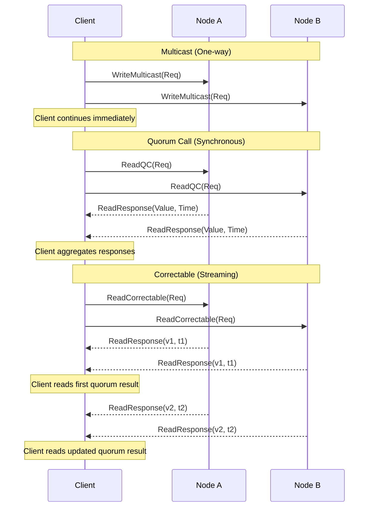
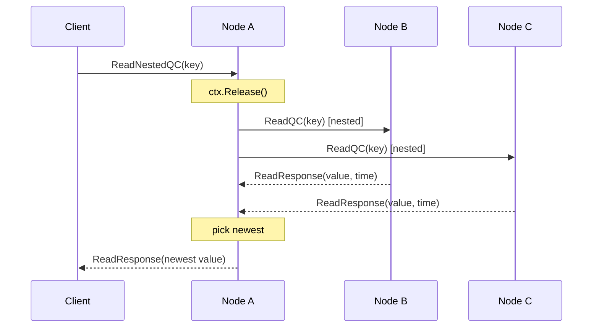
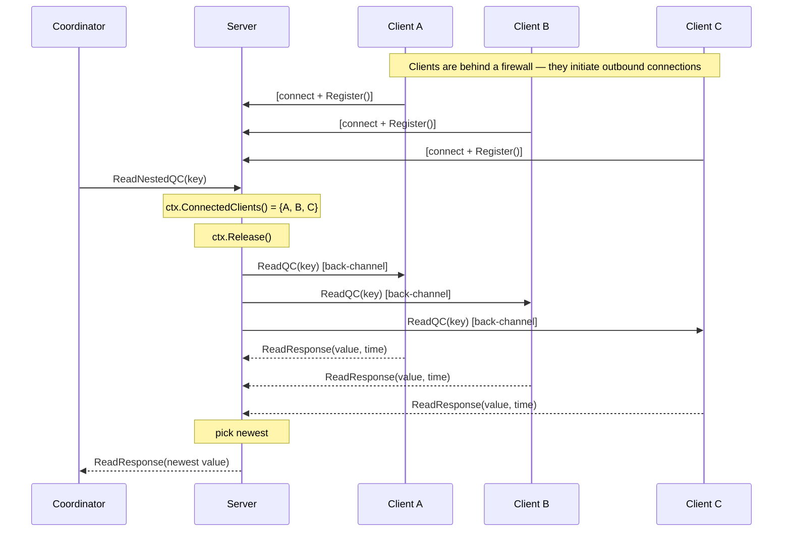
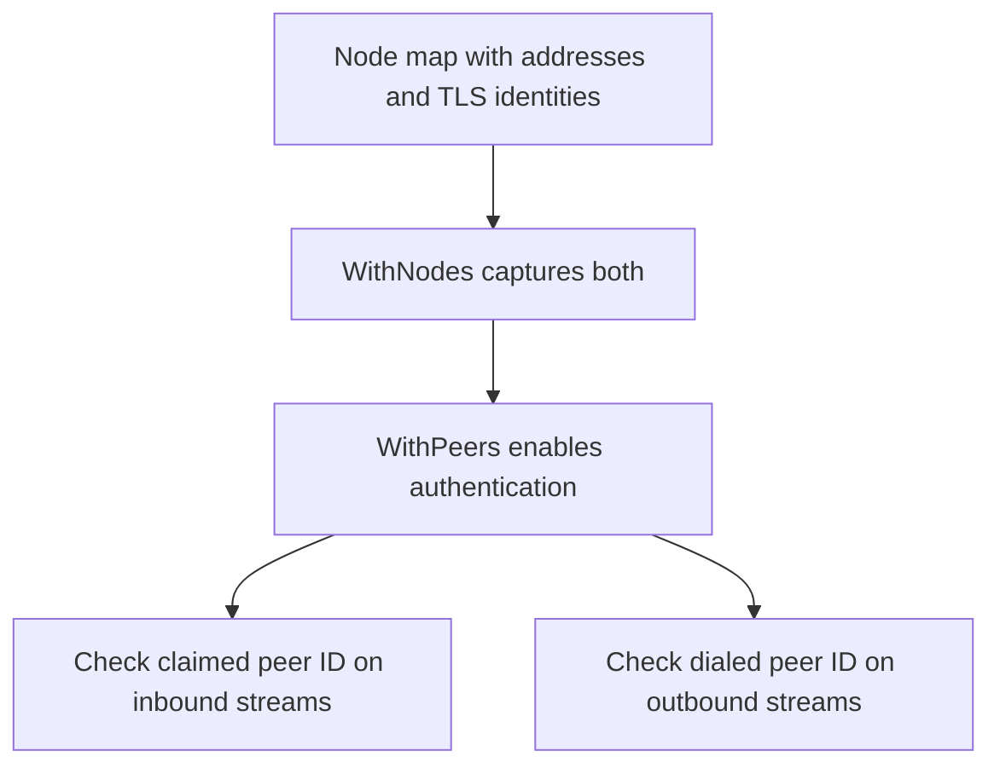

# User Guide

Author: Hein Meling

You may wish to read the gRPC [Getting Started documentation](http://www.grpc.io/docs/) before continuing.
Gorums uses gRPC under the hood, and exposes some of its configuration.
Gorums also uses [Protocol Buffers](https://developers.google.com/protocol-buffers) to specify messages and RPC methods.

## Prerequisites

This guide describes how to use Gorums as a user.
The guide requires a working Go installation.
At least Go version 1.26 is required.

There are a few tools that need to be installed first:

1. Install version 3 of `protoc`, the Protocol Buffers Compiler.
   Installation of this tool is OS/distribution specific.

   On Linux/macOS/WSL with Homebrew you can use:

   ```shell
   brew install protobuf
   ```

   See the [releases](https://github.com/google/protobuf/releases) page for details and other releases.

2. Install the [Go code generator](https://github.com/protocolbuffers/protobuf-go) for `protoc`.
   It can be installed with the following command:

   ```shell
   go install google.golang.org/protobuf/cmd/protoc-gen-go@latest
   ```

3. Install the Gorums plugin:

   ```shell
   go install github.com/relab/gorums/cmd/protoc-gen-gorums@latest
   ```

## Creating and Compiling a Protobuf Service Description into Gorums Code

In this example we will create a simple storage service.
The storage can store a single `{value, timestamp}` tuple with methods for reading and writing state.

First, we define our storage as a gRPC service by using the protocol buffers interface definition language (IDL).
Refer to the protocol buffers [language guide](https://developers.google.com/protocol-buffers/docs/proto3) to learn more about the Protobuf IDL.

The runnable version of this example lives in `examples/storage`.
The protobuf definition for that example lives in `examples/storage/proto/storage.proto`.
If you are starting from scratch, you can still create your own module and use the same proto structure.

```shell
mkdir $HOME/storageexample
cd $HOME/storageexample
go mod init storageexample
go get github.com/relab/gorums
```

### Call Types

Gorums offers several call types including quorum calls, and one-way unicast and multicast communication.
To select a call type for a Protobuf service method, specify one of the following options (they cannot be combined):

| Call type               | Gorums option                  | Description                                                                                                                                     |
| ----------------------- | ------------------------------ | ----------------------------------------------------------------------------------------------------------------------------------------------- |
| Ordered RPC             | no option                      | FIFO-ordered synchronous RPC to a single node.                                                                                                  |
| Unicast                 | `gorums.unicast`               | FIFO-ordered one-way asynchronous unicast.                                                                                                      |
| Multicast               | `gorums.multicast`             | FIFO-ordered one-way asynchronous multicast.                                                                                                    |
| Quorum Call             | `gorums.quorumcall`            | FIFO-ordered asynchronous quorum call on a configuration of nodes.                                                                              |
| Synchronous Quorum Call | `gorums.quorumcall`            | Synchronous variant; chain a terminal method (`.First()`, `.Majority()`, `.All()`, `.Threshold(n)`) to block until the quorum threshold is met. |
| Correctable             | `gorums.quorumcall` + `stream` | Streaming quorum call; use `.Correctable(n)` to observe progressive updates as nodes respond.                                                   |

The generated API is similar to unary gRPC, unless the `stream` keyword is used in the proto definition.
Server streaming is only supported for quorum calls.
Client streaming is not supported.



### Configuring Call Types in Protobuf

The following is a partial representation of `examples/storage/proto/storage.proto`, showing one RPC per call type.
The full service definition includes additional RPCs (e.g., `WriteRPC`, `WriteQC`) for completeness, but the examples here focus on one representative per call type.

```proto
edition = "2024";

package proto;
option go_package = "github.com/relab/gorums/examples/storage/proto";
option features.field_presence = IMPLICIT;
option features.enforce_naming_style = STYLE_LEGACY;

import "google/protobuf/empty.proto";
import "google/protobuf/timestamp.proto";
import "gorums.proto";

// Storage service defines the RPCs for a simple key-value storage system.
service Storage {
  // ReadRPC is a FIFO-ordered RPC to a single node.
  rpc ReadRPC(ReadRequest) returns (ReadResponse) {}

  // WriteUnicast is an asynchronous unicast to a single node.
  // No reply is collected.
  rpc WriteUnicast(WriteRequest) returns (google.protobuf.Empty) {
    option (gorums.unicast) = true;
  }

  // WriteMulticast is an asynchronous multicast to all nodes in a configuration.
  // No replies are collected.
  rpc WriteMulticast(WriteRequest) returns (google.protobuf.Empty) {
    option (gorums.multicast) = true;
  }

  // ReadQC is a FIFO-ordered synchronous quorum call.
  // Use terminal methods (.Majority(), .First(), etc.) to retrieve results.
  // Use .Async() to send at once and collect later, .Correctable(n) for progressive results.
  rpc ReadQC(ReadRequest) returns (ReadResponse) {
    option (gorums.quorumcall) = true;
  }

  // ReadCorrectable is a FIFO-ordered synchronous quorum call with server streaming.
  // The stream keyword enables correctable calls where nodes can send multiple
  // progressive updates. Use .Correctable(n) to watch for updates as they arrive.
  rpc ReadCorrectable(ReadRequest) returns (stream ReadResponse) {
    option (gorums.quorumcall) = true;
  }
}

// ReadRequest is the request message for Read RPCs and Read quorum calls.
message ReadRequest {
  string key = 1;
}

// ReadResponse is the response message for Read RPCs and Read quorum calls.
message ReadResponse {
  bool                      OK    = 1;
  string                    value = 2;
  google.protobuf.Timestamp time  = 3;
}

// WriteRequest is the request message for Write unicast and multicast calls.
message WriteRequest {
  string                    key   = 1;
  string                    value = 2;
  google.protobuf.Timestamp time  = 3;
}
```

For the `unicast` and `multicast` call types, the response message type will be unused by Gorums.

> **Reserved names:** The following names are reserved by Gorums: `Config`, `ID`, `Node`, `NodeContext`, `ConfigContext`.
> A message field named `ID` is fine; only type names are reserved.
> Gorums injects type aliases with these names into every generated `_gorums.pb.go` file, so the names cannot be used for messages, enums, or RPC methods in any `.proto` file of the same Go package.
> The generator reports an error for a `.proto` file that uses one of them.

### Compiling the Service Definition

Next, we compile our service definition into Go code which includes:

1. Go code to access and manage the defined Protobuf messages.
2. A Gorums client API and server interface for the storage.

We simply invoke `protoc` to compile our Protobuf definition:

```shell
protoc -I="$(go list -m -f {{.Dir}} github.com/relab/gorums):." \
  --go_out=paths=source_relative:. \
  --gorums_out=paths=source_relative:. \
  storage.proto
```

The above step should produce two files named `storage.pb.go` and `storage_gorums.pb.go` in your package directory.
The former contains the Protobuf definitions of our messages.
The latter contains the Gorums generated client and server interfaces.

### Examining the Gorums Generated Code

Let us examine the `storage_gorums.pb.go` file to see the code generated from our Protobuf definitions.
The client functions below are generated by Gorums based on the call type specified in the Protobuf definition.
The first two functions are used to send requests to a single node determined by the `NodeContext`.

```go
func ReadRPC(ctx *gorums.NodeContext, in *ReadRequest) (resp *ReadResponse, err error)
func WriteUnicast(ctx *gorums.NodeContext, in *WriteRequest) *gorums.OnewayCall[*WriteRequest]
```

The three functions below are used to send requests to a configuration of nodes determined by the `ConfigContext`.
The quorum-call functions return a `*gorums.Call[*ReadRequest, *ReadResponse]`, which embeds `*gorums.Responses[*ReadResponse]` and adds `Intercept`.
The one-way `WriteMulticast` returns a `*gorums.OnewayCall[*WriteRequest]`; call `.Send()` to block until every send completes and observe any send errors, or `.Async()` to dispatch without waiting.

```go
func WriteMulticast(ctx *gorums.ConfigContext, in *WriteRequest) *gorums.OnewayCall[*WriteRequest]
func ReadQC(ctx *gorums.ConfigContext, in *ReadRequest) *gorums.Call[*ReadRequest, *ReadResponse]
func ReadCorrectable(ctx *gorums.ConfigContext, in *ReadRequest) *gorums.Call[*ReadRequest, *ReadResponse]
```

And this is our server interface:

```go
type StorageServer interface {
	ReadRPC(ctx gorums.ServerContext, request *ReadRequest) (response *ReadResponse, err error)
	WriteUnicast(ctx gorums.ServerContext, request *WriteRequest)
	WriteMulticast(ctx gorums.ServerContext, request *WriteRequest)
	ReadQC(ctx gorums.ServerContext, request *ReadRequest) (response *ReadResponse, err error)
	ReadCorrectable(ctx gorums.ServerContext, request *ReadRequest, send func(response *ReadResponse))
}
```

It is worth noting that unicast and multicast methods do not return a response or error, as they are one-way calls.
The client-side functions for these methods return an error if the request could not be sent, but do not return any information about the success or failure of the request at the server side.

**Note:**
You may decide to keep the `.proto` file and the generated `.pb.go` files in a separate directory/package and import that package (the generated Gorums API) into your application.
We skip that here for the sake of simplicity.

## Implementing the StorageServer

We now describe how to implement the `StorageServer` interface from above.

```go
type storageSrv struct {
  mut   sync.Mutex
  state *ReadResponse
}

func (srv *storageSrv) ReadRPC(_ gorums.ServerContext, req *ReadRequest) (resp *ReadResponse, err error) {
  srv.mut.Lock()
  defer srv.mut.Unlock()
  return srv.state, nil
}

func (srv *storageSrv) WriteUnicast(_ gorums.ServerContext, req *WriteRequest) {
  srv.mut.Lock()
  defer srv.mut.Unlock()
  if req.GetTime().AsTime().After(srv.state.GetTime().AsTime()) {
    srv.state = &ReadResponse{OK: true, Value: req.GetValue(), Time: req.GetTime()}
  }
}

func (srv *storageSrv) WriteMulticast(_ gorums.ServerContext, req *WriteRequest) {
  srv.mut.Lock()
  defer srv.mut.Unlock()
  if req.GetTime().AsTime().After(srv.state.GetTime().AsTime()) {
    srv.state = &ReadResponse{OK: true, Value: req.GetValue(), Time: req.GetTime()}
  }
}

func (srv *storageSrv) ReadQC(_ gorums.ServerContext, req *ReadRequest) (resp *ReadResponse, err error) {
  srv.mut.Lock()
  defer srv.mut.Unlock()
  return srv.state, nil
}

func (srv *storageSrv) ReadCorrectable(_ gorums.ServerContext, req *ReadRequest, send func(response *ReadResponse)) {
  srv.mut.Lock()
  defer srv.mut.Unlock()
  send(srv.state)
}
```

There are some important things to note about implementing the server interfaces:

* The handlers run in the order messages are received.
* Messages from the same sender are executed in FIFO order at all servers, up to the point where the handler calls `ServerContext.Release`.
  See the auxiliary documentation for more information about [message ordering](./ordering.md) in Gorums.
* Messages from different senders may be received in a different order at the different servers.
  To guarantee messages from different senders are executed in-order at the different servers, you must use a total ordering protocol.
* Errors should be returned using the [`status` package](https://pkg.go.dev/google.golang.org/grpc/status?tab=doc).
* Handlers for requests from the same stream start one at a time, in arrival order.
  `ServerContext.Release` lets the next request start before the handler returns, and the handler releases automatically when it returns.
  After `ctx.Release()` has been called, the handler may run concurrently with the handlers for the next requests.
  See [Request Ordering and ServerContext.Release](#request-ordering-and-servercontextrelease).

  ```go
  func (srv *storageSrv) ReadRPC(ctx gorums.ServerContext, req *ReadRequest) (resp *ReadResponse, err error) {
    // any code running before this will be executed in-order
    ctx.Release()
    // after Release() has been called, a new request handler may be started,
    // and thus it is not guaranteed that the replies will be sent back the same order.
    srv.mut.Lock()
    defer srv.mut.Unlock()
    return srv.state, nil
  }
  ```

* The context passed to the handlers is derived from the gRPC stream context, extended with any per-request metadata carried in the incoming message.
  This context can be used to retrieve [metadata](https://github.com/grpc/grpc-go/blob/master/Documentation/grpc-metadata.md)
  and [peer](https://godoc.org/google.golang.org/grpc/peer) information from the client.

To start the server, we need to create a *listener* and a *GorumsServer*, and then register our server implementation:

```go
func ExampleStorageServer(port int) {
  lis, err := net.Listen("tcp", fmt.Sprintf(":%d", port))
  if err != nil {
    log.Fatal(err)
  }
  gorumsSrv := gorums.NewServer()
  srv := storageSrv{state: &ReadResponse{}}
  RegisterStorageServer(gorumsSrv, &srv)
  gorumsSrv.Serve(lis)
}
```

`Serve(lis)` serves on a listener you create.
Alternatively, record the address with the `WithAddr` server option and call `ListenAndServe`, which binds the address for you:

```go
gorumsSrv := gorums.NewServer(gorums.WithAddr(":8080"))
RegisterStorageServer(gorumsSrv, &srv)
go gorumsSrv.ListenAndServe()
```

`Server.Addr` reports the bound address (useful when the configured port is `0`).
`Server.Stop` stops the server immediately, closing the listener it owns and any outbound configuration.
`Server.Stop` is safe to call before serving starts.

### Request Ordering and ServerContext.Release

`ServerContext.Release` divides a handler into an ordered part and a concurrent part:

```text
handler(req):
    ┌─ ordered part ───────┐   requests from one stream pass one at a time, in arrival order
    │ assign seq, enqueue, │
    │ dispatch a relay     │
    └──────────────────────┘
    ctx.Release()
    ┌─ concurrent part ────┐   overlaps the handlers of later requests
    │ wait for replies,    │
    │ slow work, I/O       │
    └──────────────────────┘
    return reply
```

Code before `Release` runs in per-sender FIFO order.
Code after `Release` runs concurrently with the handlers of later requests from the same stream, so it must protect shared state, for example with a mutex.
A mutex gives mutual exclusion, but not arrival order, so it cannot restore an order that `Release` gave up.
A handler that does not call `Release` releases when it returns; the whole handler is then ordered, and the next request waits until the handler returns.
It is safe to call `Release` more than once.

A nested call follows the same rule: dispatching a call is ordered work, and waiting for its replies is not.
To keep a nested call in FIFO order, dispatch it before `Release` and wait for it after `Release`:

```go
func (s *storageServer) WriteMulticast(ctx gorums.ServerContext, req *pb.WriteRequest) {
    s.store(req)
    // s.next is the configuration of the next hops.
    relay := pb.WriteMulticast(s.next.Context(ctx), req).Async()
    ctx.Release()
    if err := relay.Wait(); err != nil {
        // handle the error; a one-way call has no reply to carry it
    }
}
```

`OnewayCall.Async` and `Call.Async` (see [Async and Correctable Variants](#async-and-correctable-variants)) send the requests before they return.
So when a handler dispatches its nested call before `Release`, the nested calls leave in the order in which the requests reached the handler.
A call dispatched after `Release` may overtake the same call from the handler of the next request.
That is correct only when the nested calls of different requests may run in any order, as for the nested reads in [Nested Quorum Calls with ServerContext.PeerConfig](#nested-quorum-calls-with-servercontextpeerconfig).
A handler that waits for a reply before `Release` keeps the next request waiting.
If the sender fills the stream's dispatch queue in the meantime, the wait lasts until the context ends; see [Send Queue Capacity and Backpressure](#send-queue-capacity-and-backpressure).

## Implementing the StorageClient

Next, we write client code to call RPCs on our servers.
The first thing we need to do is to create a `Config` using `gorums.NewConfig`.
`NewConfig` establishes connections to the given nodes and returns a configuration
ready for making RPC calls, and a function that closes those connections.

We can forward gRPC dial options to `NewConfig` if needed.
Below we use only a simple insecure connection option.

```go
package proto

import (
  "log"

  "github.com/relab/gorums"
  "google.golang.org/grpc"
  "google.golang.org/grpc/credentials/insecure"
)

func ExampleStorageClient() {
  addrs := []string{
    "127.0.0.1:8080",
    "127.0.0.1:8081",
    "127.0.0.1:8082",
  }
  // Create a configuration including all nodes
  allNodesConfig, closeFn, err := gorums.NewConfig(
    gorums.WithNodeList(addrs),
    gorums.WithGRPCDialOptions(
      grpc.WithTransportCredentials(insecure.NewCredentials()),
    ),
  )
  if err != nil {
    log.Fatalln("error creating read config:", err)
  }
  defer closeFn()
```

A configuration is a set of nodes on which RPC calls can be invoked.
`WithNodeList` assigns a unique identifier to each node by address.

The `Config` type has several useful methods for combining and filtering configurations.
Inspect the package documentation or source code for details.
Configurations derived from `allNodesConfig` share its connection pool, and only `closeFn` closes it; see [Closing Configurations](#closing-configurations).

We can now invoke the WriteUnicast RPC on each `node` in the configuration:

```go
  req := &WriteRequest{
    Key:   "mykey",
    Value: "42",
    Time:  timestamppb.Now(),
  }

  // Invoke WriteUnicast RPC on all nodes in config
  ctx := context.Background()
  for _, node := range allNodesConfig.Nodes() {
    nodeCtx := node.Context(ctx)
    err := WriteUnicast(nodeCtx, req).Send()
    if err != nil {
      log.Fatalln("write rpc returned error:", err)
    }
  }
```

While Gorums allows us to call RPCs on individual nodes as we did above, Gorums also provides call types *multicast* and *quorum call* that allow us to invoke an RPC on all nodes in a configuration with a single invocation, as we show in the next section.

## Quorum Calls

Instead of invoking an RPC explicitly on all nodes in a configuration, Gorums allows users to invoke a *quorum call* that sends RPCs to all nodes in parallel and collects responses.

Specifying the `quorumcall` option for RPC methods:

```protobuf
rpc ReadQC(ReadRequest) returns (ReadResponse) {
  option (gorums.quorumcall) = true;
}
```

The generated code provides a function for each quorum call method:

```go
func ReadQC(ctx *gorums.ConfigContext, in *ReadRequest) *gorums.Call[*ReadRequest, *ReadResponse]
```

This function returns a `*gorums.Call[*ReadRequest, *ReadResponse]` handle.
The handle embeds `*gorums.Responses[*ReadResponse]`, so it offers the same ways to aggregate and process responses, and adds `Intercept` for registering interceptors before the call is dispatched.

### Terminal Methods for Response Aggregation

The `*gorums.Responses[T]` type provides built-in *terminal methods* for common aggregation patterns:

| Method                     | Returns                                    | Returns When                           |
| -------------------------- | ------------------------------------------ | -------------------------------------- |
| `.First()`                 | The first successful response              | One node responds successfully         |
| `.Majority()`              | The first successful response              | ⌈(n+1)/2⌉ nodes respond successfully   |
| `.All()`                   | The first successful response              | All n nodes respond successfully       |
| `.Threshold(k)`            | The first successful response              | k nodes respond successfully           |
| `.Aggregate(fn)`           | The result of your function `fn`           | `fn` returns                           |
| `.Reduce(k, initial, add)` | The accumulator that `add` builds          | k nodes respond successfully           |
| `.Matching(k, key)`        | An agreement: agreed response and evidence | k nodes send responses with equal keys |

Each terminal method blocks until its condition is met or the context is canceled, then returns a single result and an error.
`First`, `Majority`, `All`, and `Threshold` count replies; they do not compare them.
Each returns one response, the first successful one to arrive.
For a read that must return the newest value, use `Aggregate` or `Reduce`.
`Threshold(k)` panics if `k` is not positive.

### Using Terminal Methods

```go
func ExampleTerminalMethods(config *Config) {
  ctx := context.Background()
  cfgCtx := config.Context(ctx)

  // Fast reads: return first successful response
  reply, err := ReadQC(cfgCtx, &ReadRequest{Key: "x"}).First()

  // Crash fault tolerance: require simple majority
  reply, err = ReadQC(cfgCtx, &ReadRequest{Key: "x"}).Majority()

  // Wait for all nodes (useful for debugging)
  reply, err = ReadQC(cfgCtx, &ReadRequest{Key: "x"}).All()

  // Custom threshold (e.g., f+1 for crash tolerance)
  f := 1
  reply, err = ReadQC(cfgCtx, &ReadRequest{Key: "x"}).Threshold(f + 1)
}
```

Terminal methods return `gorums.ErrIncomplete` when:

* The context is canceled before the threshold is met
* Not enough successful responses are received
* All nodes return errors

### Aggregate: Custom Aggregation Functions

`Aggregate(fn)` passes the response sequence to your function `fn` and returns its result.
The result type does not have to be the response type.
This lets you write the call from left to right, with the aggregation function last:

```go
resp, err := ReadQC(cfgCtx, &ReadRequest{Key: "x"}).Aggregate(newestReply)

func newestReply(
  seq gorums.ResponseSeq[*ReadResponse],
) (*ReadResponse, error) {
  var newest *ReadResponse
  for response := range seq {
    if response.Err != nil {
      continue
    }
    if newest == nil || newer(response.Value, newest) {
      newest = response.Value
    }
  }
  if newest == nil {
    return nil, gorums.ErrIncomplete
  }
  return newest, nil
}
```

The call is dispatched when `fn` starts to range over the sequence.
Your function decides how to handle each node error and when to stop.
`Aggregate` returns the error from `fn` unchanged.
`Aggregate` panics if `fn` is nil.

Use `Aggregate` when the built-in terminals do not fit.
For example, use it for correctable streams, for many updates from one node, or for a completion rule that depends on your protocol.

### Reduce: Folding Responses into State

`Reduce(n, initial, add)` folds the successful responses from up to `n` different nodes into an *accumulator*.
You choose the accumulator type.
It can be a counter, a selected response, a protocol struct, a map, or a certificate builder.

`Reduce` calls `add` once for each successful response:

* The first call gets `initial`.
  It may be nil, for example a nil map or pointer; `add` must then allocate the accumulator before it writes to it.
* Each later call gets the accumulator that the previous call returned.
* Each call gets a successful response with its `NodeID`, so the accumulator can record which nodes contributed.

`Reduce` does not pass responses with errors to `add`.
It also counts only the first successful response from each node; it ignores later responses from the same node.
`Reduce` stops after `n` successful responses and returns the accumulator.

This example collects Paxos promises from a majority of nodes.
The `PromiseQC` call and its message types are illustrative; they do not come from a proto file in this repository.

```go
// promises is the state that a proposer collects in the prepare phase.
type promises struct {
  from    []gorums.ID      // nodes that sent a promise
  highest *PromiseResponse // promise with the highest accepted round
}

func addPromise(
  acc promises,
  resp gorums.NodeResponse[*PromiseResponse],
) (promises, error) {
  if !resp.Value.GetOk() {
    return acc, fmt.Errorf("node %d: a higher round exists", resp.NodeID)
  }
  acc.from = append(acc.from, resp.NodeID)
  if acc.highest == nil || resp.Value.GetAcceptedRound() > acc.highest.GetAcceptedRound() {
    acc.highest = resp.Value
  }
  return acc, nil
}

quorum := config.Size()/2 + 1
acc, err := PromiseQC(cfgCtx, &PromiseRequest{Round: round}).
  Reduce(quorum, promises{}, addPromise)
```

`Reduce` returns an error in these cases:

* If `add` returns an error, `Reduce` returns the accumulator from that call and the same error.
* If fewer than `n` nodes respond successfully, `Reduce` returns the latest accumulator and an error that matches `gorums.ErrIncomplete`.
  This error also holds the node errors, but not the nodes that a request transform skipped.

In both cases, you can inspect the partial accumulator.
`Reduce` panics if `n` is not positive or if `add` is nil.

### Matching: Waiting for Responses That Agree

`Matching(n, key)` waits until `n` different nodes send responses that agree.
You give a `key` function that maps a response to a comparable value, such as a string or a struct with comparable fields.
Two responses agree when their keys are equal.
The key must compare by value.
A pointer key, such as the response itself, compares by address, so two responses never agree.
A key of type `any` that holds a slice compiles, but `Matching` panics when it puts the response in a bucket.

`Matching` puts each successful response in a bucket for its key.
When a bucket gets `n` responses, `Matching` returns a `gorums.Agreement[T]` with two fields:

* `Value` is the first response in that bucket.
* `Responses` holds the `n` responses in that bucket, in arrival order, each with its `NodeID`.

`Matching` counts each node at most once.
Only the first successful response from a node counts.
It ignores later responses from the same node, whatever their key.
Responses with errors never go into a bucket.

This PBFT-style example collects a *prepared certificate*.
The caller needs `2f+1` prepare responses that agree on the request digest, where `f` is the number of faulty nodes that the system tolerates.
The `PrepareQC` call and its message types are illustrative; they do not come from a proto file in this repository.

```go
// digestKey returns the request digest as a comparable key.
// A []byte is not comparable, so digestKey converts it to a string.
func digestKey(resp *PrepareResponse) string {
  return string(resp.GetDigest())
}

quorum := 2*f + 1
agreement, err := PrepareQC(cfgCtx, &PrepareRequest{View: view, Sequence: seq, Digest: digest}).
  Matching(quorum, digestKey)
if err != nil {
  return err
}
// agreement.Value is a prepare response with the agreed digest.
// agreement.Responses shows which nodes sent a matching response, so it
// serves as the prepared certificate.
```

When you need only the agreed value, use `agreement.Value` and ignore the evidence.

If no key gets `n` responses, `Matching` returns an empty agreement and a `gorums.ErrIncomplete` error.
This error also holds the node errors, but not the nodes that a request transform skipped.
`Matching` panics if `n` is not positive or if `key` is nil.

### Async and Correctable Variants

**Async dispatch.** `Async()` sends the requests at once and returns the dispatched `*gorums.Responses[T]`.
Any terminal method then collects the replies later:

```go
responses := ReadQC(cfgCtx, &ReadRequest{Key: "x"}).Async()
// Do other work...
reply, err := responses.Majority()
```

`Async` starts no goroutine.
The terminal method collects the replies on the goroutine that calls it.
Every terminal method works after `Async`, including `Aggregate`, `Reduce`, and `Matching`.
A call that you dispatch with `Async` accepts no interceptors: register them with `Intercept` before you call `Async`.
`Async` panics if the call was already dispatched.

A call buffers one reply per node, and a streaming call buffers ten.
When a streaming call gets more replies than its buffer holds, the node's receive path waits until the caller reads them or the context ends.
So read the replies of a streaming call soon after `Async`, or use `Correctable`.

**Correctable variant** provides progressive updates as more responses arrive:

| Method            | Description                | Returns           |
| ----------------- | -------------------------- | ----------------- |
| `.Correctable(n)` | Progressive updates from n | `*Correctable[T]` |

```go
corr := ReadCorrectable(cfgCtx, &ReadRequest{Key: "x"}).Correctable(2)  // Initial threshold
reply, level, err := corr.Get()
<-corr.Watch(3)  // Wait for higher level
reply, level, err = corr.Get()
```

`Correctable(n)` panics if `n` is not positive.
It panics before it sends any request.

### Send-Timing Model

Understanding when messages are actually sent matters for ordering and for reasoning about concurrent calls.

**Quorum calls are lazy.** A quorum call is not dispatched until the caller calls a terminal method (`First`, `Majority`, `All`, `Threshold`, `Aggregate`, `Reduce`, `Matching`), `Async`, or `Correctable`, or ranges over `.Results()`.
So interceptors can register per-node request transformations before any message is sent.

**Async sends immediately.** `Async()` sends the requests before it returns.
This preserves message ordering when one goroutine issues several calls in sequence:

```go
// Both calls are dispatched in order before either reply is read.
a := WriteQC(cfgCtx, reqA).Async()
b := WriteQC(cfgCtx, reqB).Async()
_, _ = a.Majority()
_, _ = b.Majority()
```

Collecting the replies one call after the other takes about as long as the slowest call, because the replies of both calls arrive in their buffers at the same time.

**Multicast and unicast are lazy too.** A one-way call returns a `*OnewayCall[Req]` handle.
The call is not dispatched until the caller calls `.Send()` or `.Async()` on the handle.
If the caller drops the handle without calling either method, the call is never dispatched.

`.Send()` and the `.Wait()` of an `.Async()` handle report every send failure, so a one-way call cannot fail silently.
Each send completes when the message reaches the stream of its node.
A one-way call has no reply, so there is nothing more to wait for.

A server handler that multicasts calls `.Async()` before `ServerContext.Release()` and `.Wait()` after it.
The sends then keep the order of the requests.
The next request also does not wait for the sends.
For details, see [Request Ordering and ServerContext.Release](#request-ordering-and-servercontextrelease).

`.Send()` blocks until the sends complete, so one goroutine holds a single outstanding message per node — the same depth a quorum call has.
`.Async()` dispatches and returns a `*OnewayAsync` whose `.Wait()` collects the errors later, letting one goroutine keep several calls in flight:

```go
handles := make([]*gorums.OnewayAsync, 0, len(batch))
for _, req := range batch {
    handles = append(handles, WriteMulticast(cfgCtx, req).Async())
}
for _, h := range handles {
    if err := h.Wait(); err != nil {
        log.Println("multicast failed:", err)
    }
}
```

`.Async()` starts no goroutine; `.Wait()` collects the send confirmations on the caller's goroutine.

Summary:

| Call type            | When messages are sent              |
| -------------------- | ----------------------------------- |
| Quorum call          | On dispatch (lazy)                  |
| Quorum call, `Async` | Immediately, before `Async` returns |
| Multicast / unicast  | On `.Send()` or `.Async()` (lazy)   |

**A cancelled call leaves the node's stream intact.**
When a call's context ends, the call returns, but the request may still be sent if it was already queued or in flight, and a late reply is discarded.
A node that stops reading its stream while its connection stays open stalls the sends behind it; two-way calls to that node then fail fast with `ErrSendQueueFull` once its queue fills, so quorum calls proceed with the remaining nodes.
While a send to a node has been blocked for a second or longer, `Node.LastErr` reports `gorums.ErrSendStalled`, so `ByLastError` orders the node last.
gRPC keepalive, enabled with `gorums.WithGRPCDialOptions(grpc.WithKeepaliveParams(...))`, detects a node whose connection or process is gone; it does not detect a live node that has stopped reading one stream, since the transport still answers keepalive pings.

## Iterator-Based Custom Aggregation

For aggregation logic beyond the built-in terminal methods, write a function that ranges over the response sequence, and pass it to `.Aggregate(fn)`.
The function takes a `gorums.ResponseSeq[Resp]` and may return any type `Out`.
Its type is `gorums.AggregateFunc[Resp, Out]`, which also serves as the return type of a function that builds one.
The sequence yields each node's response as it arrives, so the function can decide when it has enough.
Each item holds three fields:

* `Value` is the response message; it is the zero value when `Err` is set.
* `Err` is the error from that node, or nil.
* `NodeID` identifies the node.

If the function stops after a fixed number of successful responses, `Reduce` is often simpler; see [Reduce](#reduce-folding-responses-into-state).

### Basic Iterator Pattern

```go
// newestValue returns the response with the most recent timestamp.
func newestValue(seq gorums.ResponseSeq[*ReadResponse]) (*ReadResponse, error) {
  var newest *ReadResponse
  for resp := range seq {
    if resp.Err != nil {
      continue // skip failed responses
    }
    if newest == nil || resp.Value.GetTime().AsTime().After(newest.GetTime().AsTime()) {
      newest = resp.Value
    }
  }
  if newest == nil {
    return nil, gorums.ErrIncomplete
  }
  return newest, nil
}

cfgCtx := config.Context(ctx)
reply, err := ReadQC(cfgCtx, &ReadRequest{Key: "x"}).Aggregate(newestValue)

// The same function works after Async.
reply, err = ReadQC(cfgCtx, &ReadRequest{Key: "x"}).Async().Aggregate(newestValue)
```

`Aggregate` comes after `Intercept` in the chain, so the function sees the responses that the interceptors produce.

### Skipping Failed Responses

`IgnoreErrors()` returns a sequence that holds only the successful responses:

```go
func countSuccessful(seq gorums.ResponseSeq[*Response]) (int, error) {
  count := 0
  for range seq.IgnoreErrors() {
    count++
  }
  return count, nil
}
```

To skip responses on other conditions, use an `if` statement in the loop:

```go
// countValid counts the successful responses that pass isValid.
func countValid(seq gorums.ResponseSeq[*Response]) (int, error) {
  count := 0
  for resp := range seq.IgnoreErrors() {
    if !isValid(resp.Value) {
      continue // skip invalid responses
    }
    count++
  }
  return count, nil
}
```

To drop or change responses before a built-in terminal method sees them, use an interceptor; see [Interceptors for Request/Response Transformation](#interceptors-for-requestresponse-transformation).

### Per-Node Error Inspection

Range over the sequence directly when you need the error from each node:

```go
func repliesAndErrors(seq gorums.ResponseSeq[*Response]) (map[gorums.ID]*Response, error) {
  var errs []error
  replies := make(map[gorums.ID]*Response)
  for resp := range seq {
    if resp.Err != nil {
      errs = append(errs, fmt.Errorf("node %d: %w", resp.NodeID, resp.Err))
      continue
    }
    replies[resp.NodeID] = resp.Value
  }
  return replies, errors.Join(errs...)
}
```

### Early Termination

Return from the loop as soon as you have enough responses.
The call discards the replies that arrive later.

```go
func firstTwo(seq gorums.ResponseSeq[*Response]) (*Response, error) {
  count := 0
  for resp := range seq.IgnoreErrors() {
    count++
    if count == 2 {
      return resp.Value, nil
    }
  }
  return nil, gorums.ErrIncomplete
}
```

### Functions That Need the Configuration Size

The sequence does not know the size of the configuration.
When the function needs it, for example to compute a quorum, return the function from a constructor that takes the size:

```go
// validatedMajority returns the first valid response once a majority of
// the nodes have sent valid responses. Invalid responses do not count.
func validatedMajority(size int) gorums.AggregateFunc[*ReadResponse, *ReadResponse] {
  quorum := size/2 + 1
  return func(seq gorums.ResponseSeq[*ReadResponse]) (*ReadResponse, error) {
    var first *ReadResponse
    valid := 0
    for resp := range seq.IgnoreErrors() {
      if !isValid(resp.Value) {
        continue
      }
      if first == nil {
        first = resp.Value
      }
      valid++
      if valid >= quorum {
        return first, nil
      }
    }
    return nil, gorums.ErrIncomplete
  }
}

reply, err := ReadQC(cfgCtx, &ReadRequest{}).Aggregate(validatedMajority(config.Size()))
```

### Custom Return Types

The function may return a type that differs from the response type, such as a summary, a slice, or a number.

```go
// collectStats gathers the memory statistics from every node that replies.
func collectStats(seq gorums.ResponseSeq[*MemoryStat]) (*MemoryStatList, error) {
  var stats []*MemoryStat
  for resp := range seq.IgnoreErrors() {
    stats = append(stats, resp.Value)
  }
  if len(stats) == 0 {
    return nil, gorums.ErrIncomplete
  }
  return &MemoryStatList{MemoryStats: stats}, nil
}

memStats, err := StopBenchmark(cfgCtx, &StopRequest{}).Aggregate(collectStats)
```

```go
// meanThroughput returns the mean throughput of the nodes that reply.
func meanThroughput(seq gorums.ResponseSeq[*Result]) (float64, error) {
  var sum float64
  n := 0
  for resp := range seq.IgnoreErrors() {
    sum += resp.Value.GetThroughput()
    n++
  }
  if n == 0 {
    return 0, gorums.ErrIncomplete
  }
  return sum / float64(n), nil
}
```

```go
// requireAllSuccess fails at the first node error.
func requireAllSuccess(seq gorums.ResponseSeq[*Response]) (*Response, error) {
  var first *Response
  for resp := range seq {
    if resp.Err != nil {
      return nil, resp.Err
    }
    if first == nil {
      first = resp.Value
    }
  }
  if first == nil {
    return nil, gorums.ErrIncomplete
  }
  return first, nil
}
```

## Interceptors for Request/Response Transformation

Gorums provides interceptors to transform requests and responses on a per-node basis.
Register them with `Call.Intercept` (or `OnewayCall.Intercept`) before invoking a terminal or one-way method; interceptors are applied in call-site order and can be chained.

### MapRequest Interceptor

Transform requests before sending to each node:

```go
cfgCtx := config.Context(ctx)
resp, err := WriteQC(cfgCtx, req).
    Intercept(
        gorums.MapRequest[*WriteRequest, *WriteResponse](func(req *WriteRequest, node *gorums.Node) *WriteRequest {
            // Customize request for each node
            return &WriteRequest{Value: fmt.Sprintf("%s-node-%d", req.Value, node.ID())}
        }),
    ).
    Majority()
```

Go cannot infer the response type from the function argument, so `MapRequest` needs explicit type arguments: `MapRequest[Req, Resp]`.
Likewise, `MapResponse` needs the request type: `MapResponse[Req]`.

### MapResponse Interceptor

Transform responses received from each node:

```go
resp, err := ReadQC(cfgCtx, req).
    Intercept(
        gorums.MapResponse[*ReadRequest](func(resp *ReadResponse, node *gorums.Node) *ReadResponse {
            // Transform response, e.g., add node ID
            resp.NodeID = node.ID()
            return resp
        }),
    ).
    Majority()
```

### Multicast/Unicast with MapRequest

```go
// Send different messages to each node in a multicast
cfgCtx := config.Context(ctx)
WriteMulticast(cfgCtx, &WriteRequest{}).
    Intercept(
        gorums.MapRequest[*WriteRequest, *emptypb.Empty](func(msg *WriteRequest, node *gorums.Node) *WriteRequest {
            return &WriteRequest{Value: fmt.Sprintf("node-%d", node.ID())}
        }),
    ).
    Send()
```

One-way calls have no response type, so their interceptors use `*emptypb.Empty` (from `google.golang.org/protobuf/types/known/emptypb`) as `Resp`.

**Note:** If `MapRequest` returns `nil` for a node, the message will not be sent to that node.

### Custom Interceptors

Beyond the built-in `MapRequest` and `MapResponse` interceptors, you can create custom interceptors for logging, filtering, or other cross-cutting concerns.

A custom interceptor has the signature:

```go
func(ctx *gorums.CallContext[Req, Resp], next gorums.ResponseSeq[Resp]) gorums.ResponseSeq[Resp]
```

The interceptor receives:

* `ctx` - the `CallContext` providing access to:
  * `.Request()` - the original request
  * `.Config()` - the configuration being used
  * `.Method()` - the RPC method name
  * `.Nodes()` - all nodes in the configuration
  * `.Node(id)` - get a specific node by ID
  * `.Size()` - number of nodes in the configuration
* `next` - the response iterator from the previous interceptor (or the default iterator)

The interceptor returns a new `ResponseSeq` that wraps `next` with custom logic.

#### Chaining Interceptors

Multiple interceptors can be passed to `Intercept` and are executed in order:

```go
cfgCtx := config.Context(ctx)
resp, err := ReadQC(cfgCtx, req).
    Intercept(
        loggingInterceptor,
        gorums.MapRequest[*ReadRequest, *ReadResponse](transformFunc),
        filterInterceptor,
    ).
    Majority()
```

#### Example: Logging Interceptor

Create a logging interceptor that wraps the response iterator:

```go
func LoggingInterceptor[Req, Resp proto.Message](
    ctx *gorums.CallContext[Req, Resp],
    next gorums.ResponseSeq[Resp],
) gorums.ResponseSeq[Resp] {
    startTime := time.Now()
    log.Printf("[%s] Starting quorum call with request: %v", ctx.Method(), ctx.Request())

    // Wrap the response iterator to log each response
    return func(yield func(gorums.NodeResponse[Resp]) bool) {
        count := 0
        for resp := range next {
            count++
            if resp.Err != nil {
                log.Printf("[%s] Node %d error: %v", ctx.Method(), resp.NodeID, resp.Err)
            } else {
                log.Printf("[%s] Node %d response received", ctx.Method(), resp.NodeID)
            }
            if !yield(resp) {
                log.Printf("[%s] Iteration stopped after %d responses", ctx.Method(), count)
                return
            }
        }
        log.Printf("[%s] Completed: %d responses in %v", ctx.Method(), count, time.Since(startTime))
    }
}

// Usage
resp, err := ReadQC(cfgCtx, req).
    Intercept(LoggingInterceptor[*ReadRequest, *ReadResponse]).
    Majority()
```

#### Example: Response Filtering Interceptor

Filter out responses that don't meet certain criteria:

```go
func FilterInterceptor[Req, Resp proto.Message](
    shouldInclude func(Resp) bool,
) gorums.ClientInterceptor[Req, Resp] {
    return func(ctx *gorums.CallContext[Req, Resp], next gorums.ResponseSeq[Resp]) gorums.ResponseSeq[Resp] {
        return func(yield func(gorums.NodeResponse[Resp]) bool) {
            for resp := range next {
                // Skip responses that don't pass the filter
                if resp.Err == nil && !shouldInclude(resp.Value) {
                    continue
                }
                if !yield(resp) {
                    return
                }
            }
        }
    }
}

// Usage: only include responses with timestamp > threshold
threshold := time.Now().Add(-1 * time.Hour)
resp, err := ReadQC(cfgCtx, req).
    Intercept(
        FilterInterceptor[*ReadRequest, *ReadResponse](func(r *ReadResponse) bool {
            return r.GetTime().AsTime().After(threshold)
        }),
    ).
    Majority()
```

#### Example: Counting Interceptor

Count responses passing through the interceptor:

```go
func CountingInterceptor[Req, Resp proto.Message](
    counter *int,
) gorums.ClientInterceptor[Req, Resp] {
    return func(_ *gorums.CallContext[Req, Resp], next gorums.ResponseSeq[Resp]) gorums.ResponseSeq[Resp] {
        return func(yield func(gorums.NodeResponse[Resp]) bool) {
            for resp := range next {
                *counter++
                if !yield(resp) {
                    return
                }
            }
        }
    }
}
```

**Note:** Custom interceptors can be defined in any package. The `CallContext` type and `ClientInterceptor` signature are exported from the gorums package.

### Server-Side Interceptors

Gorums also supports server-side interceptors that wrap inbound RPC handlers, similar to gRPC server interceptors.
A server-side interceptor implements the `gorums.ServerInterceptor` signature:

```go
type ServerInterceptor func(ctx gorums.ServerContext, in *gorums.Message, next gorums.Handler) (*gorums.Message, error)
```

You can pass multiple interceptors when starting a Gorums server. They can perform logging, latency injection, metadata insertion, and request validation before sending the request to the handler.

Below are several examples based on the `examples/interceptors` package.

#### Server-Side Logging Interceptor

```go
func LoggingInterceptor(addr string) gorums.ServerInterceptor {
    return func(ctx gorums.ServerContext, in *gorums.Message, next gorums.Handler) (*gorums.Message, error) {
        req := gorums.AsProto[proto.Message](in)
        log.Printf("[%s]: LoggingInterceptor(incoming): Method=%s, Message=%s", addr, in.GetMethod(), req)

        start := time.Now()
        out, err := next(ctx, in)

        duration := time.Since(start)
        resp := gorums.AsProto[proto.Message](out)
        log.Printf("[%s]: LoggingInterceptor(outgoing): Method=%s, Duration=%s, Err=%v, Message=%v", addr, in.GetMethod(), duration, err, resp)
        return out, err
    }
}
```

#### Delay and Metadata Interceptors

Interceptors can inject arbitrary delays based on client properties or attach metadata to the incoming requests:

```go
func DelayedInterceptor(ctx gorums.ServerContext, in *gorums.Message, next gorums.Handler) (*gorums.Message, error) {
    delay := 50 * time.Millisecond
    time.Sleep(delay)
    return next(ctx, in)
}

func MetadataInterceptor(ctx gorums.ServerContext, in *gorums.Message, next gorums.Handler) (*gorums.Message, error) {
    // Inject a custom metadata field for the handler
    entry := &gorums.MetadataEntry{}
    entry.SetKey("customKey")
    entry.SetValue("customValue")
    in.SetEntry([]*gorums.MetadataEntry{entry})

    return next(ctx, in)
}
```

#### Rejecting Requests (Filtering)

A server interceptor can also stop a request from reaching the handler entirely.

```go
// NoFooAllowedInterceptor rejects requests for messages with key "foo".
func NoFooAllowedInterceptor[T interface{ GetKey() string }](ctx gorums.ServerContext, in *gorums.Message, next gorums.Handler) (*gorums.Message, error) {
    if req, ok := gorums.AsProto[proto.Message](in).(T); ok {
        if req.GetKey() == "foo" {
            return nil, fmt.Errorf("requests for key 'foo' are not allowed")
        }
    }
    return next(ctx, in)
}
```

## Server Configuration Callbacks

Two server options expose hooks that fire at connection or configuration change time.
Both are passed to `gorums.NewServer` as `ServerOption` values.

### WithConnectCallback

`WithConnectCallback` registers a function called each time a node opens or reopens a stream to this server.

**Signature:**

```go
gorums.WithConnectCallback(func(ctx context.Context) {})
```

**When it runs:** immediately after a new stream is accepted by the server, before any messages are processed on that stream.

**What is available:** the `context.Context` is the gRPC stream context.
`metadata.FromIncomingContext(ctx)` returns all key/value metadata pairs sent by the connecting client.
`peer.FromContext(ctx)` (from `google.golang.org/grpc/peer`) returns the remote network address.

**Safe side effects:** reading metadata, logging, writing to atomics, or signaling a channel.
The callback runs synchronously during stream setup — keep it fast and do not call back into the `*gorums.Server`.

#### Example: Logging Incoming Metadata

The following example shows how a server can extract a custom `client-id` metadata value sent by each connecting node.
This pattern is exercised in `server_test.go`.

```go
gorumsSrv := gorums.NewServer(
    gorums.WithConnectCallback(func(ctx context.Context) {
        md, ok := metadata.FromIncomingContext(ctx)
        if !ok {
            return
        }
        if vals := md.Get("client-id"); len(vals) > 0 {
            log.Printf("peer connected, client-id=%s", vals[0])
        }
    }),
)
```

The connecting client attaches the metadata with `WithMetadata`:

```go
config, closeFn, err := gorums.NewConfig(
    gorums.WithNodeList(addrs),
    gorums.WithMetadata(metadata.New(map[string]string{"client-id": "replica-3"})),
    gorums.WithGRPCDialOptions(grpc.WithTransportCredentials(insecure.NewCredentials())),
)
if err != nil {
    return err
}
defer closeFn()
```

### WithPeerChange

`WithPeerChange` registers a `func(gorums.Config)` callback.
The callback is called after every change to the known-peer configuration — that is, each time a pre-configured peer connects or disconnects.

**Signature:**

```go
gorums.WithPeerChange(func(cfg gorums.Config) { ... })
```

**When it runs:** after every change to the known-peer configuration.
For peer connect/disconnect events, the callback runs inside the server's internal configuration lock, immediately after the configuration slice has been replaced.
The callback also fires during `NewServer` construction with the initial configuration, which contains only the self-node when no peers have connected yet.

**What is available:** a configuration of connected known peers, sorted by node ID.
The self-node (this server's own ID) is always included regardless of connectivity.

**Safe side effects:** signaling a channel, writing to an atomic, or copying the slice.
For connect/disconnect-triggered callbacks, the callback is invoked while holding the internal lock, so it must **not** call `srv.ConnectedPeers()` or any other method that acquires the same lock.
Do not perform blocking or long-running work inside the callback, including during the initial construction-time call.

#### Example: Reacting to Peer Membership Changes

The following example shows how a server can wait until a quorum of peers is connected before beginning to serve requests.

```go
const quorumSize = 2 // majority for a three-node cluster, including self

ready := make(chan struct{}, 1)

gorumsSrv := gorums.NewServer(
    gorums.WithPeers(myNodeID, gorums.WithNodeList(peerAddrs),
        gorums.WithGRPCDialOptions(grpc.WithTransportCredentials(insecure.NewCredentials())),
    ),
    gorums.WithPeerChange(func(cfg gorums.Config) {
        if len(cfg) >= quorumSize {
            select {
            case ready <- struct{}{}:
            default:
            }
        }
    }),
)

// Block until a quorum connects before accepting client requests.
<-ready
log.Println("quorum ready, starting to serve")
```

The self-node is always present in `cfg`, so a three-node cluster (`quorumSize = 2`) will fire the signal as soon as a single remote peer connects.

## Waiting for Configuration

`Server.WaitForPeers` and `Server.WaitForClients` block until a condition on the configuration is satisfied, or until the context is cancelled or the system is stopped.
They replace the need to poll `ConnectedPeers()` in a loop and eliminate the latency and CPU overhead of polling.

```go
// Block until all three known peers are connected.
ctx, cancel := context.WithTimeout(context.Background(), 10*time.Second)
defer cancel()
if err := srv.WaitForPeers(ctx, func(cfg gorums.Config) bool {
    return cfg.Size() == 3
}); err != nil {
    log.Fatal("peers did not connect in time:", err)
}
```

The condition is checked immediately against the current configuration, so the call returns without blocking if the condition is already satisfied.

### WaitForPeers

`WaitForPeers` waits on the connected-peer configuration — the subset of `PeerConfig()` that is currently reachable, plus the local node itself (see `ConnectedPeers()`).
Use this when you need a quorum of static cluster members to be present before beginning to serve requests.

```go
err := srv.WaitForPeers(ctx, func(cfg gorums.Config) bool {
    return cfg.Size() >= quorumSize
})
```

### WaitForClients

`WaitForClients` waits on the client-peer configuration — the set of anonymous clients that have connected dynamically and are reachable for back-channel calls.
Use this when a server should not proceed until a minimum number of clients have registered.

```go
err := srv.WaitForClients(ctx, func(cfg gorums.Config) bool {
    return cfg.Size() >= expectedClients
})
```

### Return values

| Condition                         | Return value        |
| --------------------------------- | ------------------- |
| `cond` returns `true`             | `nil`               |
| `ctx` is cancelled or times out   | `ctx.Err()`         |
| `srv.Stop()` called before `cond` | `gorums.ErrStopped` |

### Relationship to `onChange`

`WaitForPeers` and the `onChange` callback (see [WithPeerChange](#withpeerchange)) serve complementary purposes.
`onChange` is suited for reactive work that must happen synchronously on every configuration change — for example, triggering a leader election or updating an atomic counter.
`WaitForPeers` is suited for startup synchronization — blocking until the cluster reaches a desired state before the application begins normal operation.
Unlike `onChange`, `WaitForPeers` composes naturally with `context.WithTimeout` and `context.WithCancel`.

## Error Handling

Gorums provides structured error types to help you understand and handle failures in quorum calls.
The primary error type is `QuorumCallError`, which contains detailed information about which nodes failed and why.

### QuorumCallError

A `QuorumCallError` is returned when a quorum call fails.
It provides the following methods:

* **`Cause() error`** - Returns the underlying cause of the failure (e.g., `ErrIncomplete`, `ErrSendFailure`)
* **`NumErrors() int`** - Returns the number of nodes that failed
* **`Unwrap() []error`** - Supports error unwrapping for use with `errors.Is` and `errors.As`

The error implements Go's standard error unwrapping interface, allowing `errors.Is()` and `errors.As()` to check both the direct cause and any wrapped node-specific errors.

#### Common Error Causes

Gorums defines several sentinel errors that commonly appear as the cause of a `QuorumCallError`:

* **`ErrIncomplete`** - The call could not be completed due to insufficient non-error replies to form a quorum
* **`ErrSendFailure`** - Message sending failed for one or more nodes

### Error Handling Example

Here's how to properly handle errors from a quorum call:

```go
func handleQuorumCall(config *gorums.Config, req *ReadRequest) {
  ctx, cancel := context.WithTimeout(context.Background(), 5*time.Second)
  defer cancel()

  cfgCtx := config.Context(ctx)
  reply, err := ReadQC(cfgCtx, req).Majority()

  if err != nil {
    // Check if it's a QuorumCallError
    var qcErr gorums.QuorumCallError
    if errors.As(err, &qcErr) {
      log.Printf("Quorum call failed: %v", qcErr.Cause())
      log.Printf("Failed nodes: %d", qcErr.NumErrors())

      // Handle specific cause types
      if errors.Is(err, gorums.ErrIncomplete) {
        // Not enough replies to form a quorum
        log.Println("Insufficient responses to reach quorum")
      }
    }

    // Check for context errors
    if errors.Is(err, context.DeadlineExceeded) {
      log.Println("Quorum call timed out")
    } else if errors.Is(err, context.Canceled) {
      log.Println("Quorum call was canceled")
    }
    return
  }

  // Process successful reply
  log.Printf("Read successful: %v", reply)
}
```

### Checking for Specific Error Types

Use `errors.Is()` and `errors.As()` to check for specific error types, including both the direct cause and any node-specific errors:

```go
// Check if the error is caused by insufficient responses
if errors.Is(err, gorums.ErrIncomplete) {
  // Handle incomplete quorum
}

// Check if any node returned a specific gRPC error
if errors.Is(err, status.Error(codes.Unavailable, "")) {
  // Handle unavailable nodes
}

// Extract custom error types from node failures
var customErr MyCustomError
if errors.As(err, &customErr) {
  // Handle custom error from a node
}
```

## Handling Failed Nodes in Configurations

When a quorum call fails, you can create a new configuration that excludes the failed nodes.
The `WithoutErrors` method allows you to filter nodes based on the errors they returned:

```go
import (
  "context"
  "errors"
  "io"

  "github.com/relab/gorums"
)

// Invoke a quorum call
cfgCtx := config.Context(ctx)
state, err := ReadQC(cfgCtx, &ReadRequest{}).Majority()
if err != nil {
  var qcErr gorums.QuorumCallError
  if errors.As(err, &qcErr) {
    // Option 1: Exclude all failed nodes
    newConfig := config.WithoutErrors(qcErr)

    // Option 2: Exclude only nodes with specific error types
    // For example, exclude only nodes that timed out
    newConfig = config.WithoutErrors(qcErr, context.DeadlineExceeded)

    // Option 3: Exclude nodes with multiple specific error types
    newConfig = config.WithoutErrors(qcErr,
      context.DeadlineExceeded,
      context.Canceled,
      io.EOF,
    )

    // Retry the operation with the new configuration
    newCfgCtx := newConfig.Context(ctx)
    state, err = ReadQC(newCfgCtx, &ReadRequest{}).Majority()
  }
}
```

The error type matching uses `errors.Is`, which properly handles wrapped errors.
This allows you to filter nodes based on the underlying cause of their failures, enabling fine-grained control over which nodes to exclude when creating new configurations.

## Refused Streams

A server refuses a stream when it ends the stream before it sends any message on it.
For example, a server refuses a peer that fails its identity check (see [Authenticating Peers](#authenticating-peers)), and a server stream interceptor can refuse a client.
A node treats a stream as refused when the stream ends with `codes.Unauthenticated`, `codes.PermissionDenied`, `codes.InvalidArgument`, or `codes.Unimplemented` before it delivered a message.
A new stream to the same server would fail the same way, so the node fails its calls and waits before it tries again:

| After a refusal | Behavior |
| --- | --- |
| Calls on the refused stream | Two-way and streaming calls fail with the refusal's status; they are not resent. A one-way call whose send fails on the refused stream also fails with the refusal. A one-way call sent before the refusal arrived counts as sent. |
| New streams | The node backs off: 50 ms after the first refusal, doubling after each further refusal up to 2 s. With eager reconnection, the node opens the next stream when the backoff ends; otherwise, the first call after the backoff opens it. |
| Calls during the backoff | They fail at once with the refusal. |
| `Node.LastErr` | It reports the refusal. A newer error, such as `Unavailable`, may replace it. It reverts to nil only once a stream proves viable: the stream delivers a message, or a send succeeds on a stream that has lived 2 s. |
| Connection state | Each new stream counts as connected as soon as it opens, before the server accepts or refuses it. |

Connection state is optimistic, so it does not confirm that the server accepted a stream:

* A refused stream counts as connected until its refusal arrives; a slow server or network extends this interval.
* Once per backoff period, a refused peer's `ConnectedPeers` view can include the refusing server, and `WithPeerChange` can report an up/down pair.
* Under `WithStreamDedup`, `WaitForAll` can return even if the server refuses every stream.

With one-way-only traffic and GOAWAY rotation that keeps every stream shorter than 2 s, `LastErr` can keep a stale refusal after the server accepts again, even while messages reach the server.

A stream that ends with any other status, or that ends after it delivered a message, is lost, not refused: the node resends its two-way calls on a new stream.

## Working with Configurations

Below is an example demonstrating how to work with configurations.
These configurations are viewed from the client's perspective, and to actually make quorum calls on these configurations, there must be server endpoints to connect to.
Error handling is omitted for brevity except where the result is used.

In the example below, we simply use fixed quorum sizes.

```go
func ExampleConfigClient() {
  addrs := []string{
    "127.0.0.1:8080",
    "127.0.0.1:8081",
    "127.0.0.1:8082",
  }
  // Create base configuration c1 from addrs, giving |c1| = 3.
  c1, closeFn, err := gorums.NewConfig(
    gorums.WithNodeList(addrs),
    gorums.WithGRPCDialOptions(
      grpc.WithTransportCredentials(insecure.NewCredentials()),
    ),
  )
  if err != nil {
    log.Fatalln("error creating configuration:", err)
  }
  defer closeFn()

  newAddrs := []string{
    "127.0.0.1:9080",
    "127.0.0.1:9081",
  }
  // Extend c1 with newAddrs; c2 shares c1's connection pool, |c2| = |c1| + |newAddrs| = 5.
  c2, _ := c1.Extend(gorums.WithNodeList(newAddrs))

  // c3 = nodes in c2 not in c1, giving |c3| = |newAddrs| = 2.
  c3 := c2.Difference(c1)

  // c4 = union of c1 and c3, giving |c4| = |c1| + |c3| = 3+2 = 5.
  c4 := c1.Union(c3)

  // c5 = c1 without its first node, giving |c5| = |c1| - 1 = 2.
  c5 := c1.Remove(c1.NodeIDs()[0])

  // c6 = c2 without c1, giving |c6| = |c2| - |c1| = 5-3 = 2.
  c6 := c2.Difference(c1)

  // Example: Handling quorum call failures and creating a new configuration
  // without failed nodes.
  cfgCtx := c1.Context(context.Background())
  state, err := ReadQC(cfgCtx, &ReadRequest{}).Majority()
  if err != nil {
    var qcErr gorums.QuorumCallError
    if errors.As(err, &qcErr) {
      // Create a new configuration excluding all nodes that failed.
      c7 := c1.WithoutErrors(qcErr)

      // Or exclude only nodes with specific error types (e.g., timeout errors).
      c8 := c1.WithoutErrors(qcErr, context.DeadlineExceeded)
    }
  }
}
```

### Closing Configurations

All configurations derived from one `NewConfig` call share one connection pool.
In the example above, `c1` through `c8` share the pool that `NewConfig` created, and `c2` added two nodes to it.
Only the close function that `NewConfig` returned closes the pool.
A derived configuration is a view of the pool and has no `Close` method, so closing one view cannot affect another.
To stop using some nodes, derive a smaller configuration with `Remove` or `Difference`.

The close function closes every node in the pool, including the nodes that `Extend` added.
After the close function returns, calls to the pool's nodes fail with an `Unavailable` "node closed" error.
`Extend` on any configuration in the pool also returns an error.
There is one exception: a node that runs in-process, or that reuses a server's inbound stream, owns no connection, so it stays usable.
The close function is idempotent and safe for concurrent use.
It returns no error, because closing a connection has no failure that a caller can act on.

A `Server` configured with `WithPeers` owns its peer configuration, and `Stop` and `GracefulStop` close it.

## Node IDs

Gorums identifies each node with a `gorums.ID`.
The type is an alias for `uint32`, so a value from a protobuf `uint32` field needs no conversion.

### Rules for Node IDs

* ID 0 is reserved.
  It marks a handler-only server and a client that announces no ID.
* With `WithNodes`, the application chooses the ID of each node.
  With `WithNodeList`, Gorums assigns IDs in list order, starting after the highest ID in the configuration's connection pool, or from 1 for a new pool.
* Servers configured with `WithPeers` must agree on the ID of each peer, because a server announces its own ID when it connects.
* A server assigns IDs from 2^20 upward to back-channel clients, and it skips configured IDs.
* Under `WithStreamDedup`, the peer with the lower ID dials the other.

### Choosing Node IDs

Many protocols number their replicas from 1 to n, and use the number for leader rotation, slice indexes, or signature bitfields.
Use these numbers directly as Gorums IDs:

```go
type replica struct {
  addr string
}

func (r replica) Addr() string { return r.addr }

nodes := map[gorums.ID]replica{
  1: {addr: "10.0.0.1:9000"},
  2: {addr: "10.0.0.2:9000"},
  3: {addr: "10.0.0.3:9000"},
}
srv := gorums.NewServer(
  gorums.WithPeers(myID, gorums.WithNodes(nodes), dialOpts),
)
```

Give each node an explicit ID in the cluster configuration, and let each node read its own ID from that configuration.
An explicit ID stays the same when the address list changes.
If you derive IDs from an address list instead, sort the list first, as the storage example does, so that all nodes compute the same IDs.

### Mapping Application IDs to Node IDs

An application may identify nodes by strings, such as host names or UUIDs.
Then give each node a Gorums ID in the shared cluster configuration, and keep a map in each direction:

```go
type member struct {
  Name    string    // application ID
  ID      gorums.ID // Gorums ID
  Address string
}

func (m member) Addr() string { return m.Address }

byID := make(map[gorums.ID]member)
idOf := make(map[string]gorums.ID)
for _, m := range members {
  byID[m.ID] = m
  idOf[m.Name] = m.ID
}
cfg, closeFn, err := gorums.NewConfig(gorums.WithNodes(byID), dialOpts)
```

`cfg.Node(idOf[name])` returns the node for an application ID, or nil if the configuration has no such node.
`byID[id].Name` returns the application ID for a Gorums ID.

Nodes that join without a shared configuration can derive their IDs from their names with a hash, so that all nodes compute the same ID without coordination:

```go
func idOf(name string) gorums.ID {
  h := fnv.New32a()
  h.Write([]byte(name))
  return max(h.Sum32(), 1) // ID 0 is reserved
}
```

Two names can hash to the same 32-bit ID; the probability is about one in a million for 100 nodes.
Check for duplicate IDs when you build the node map.
Do not use hashed IDs in a protocol that needs IDs from 1 to n.

### Finding the Sender of a Request

A handler gets the ID of the node that sent a request from `ServerContext.SenderID`.
With `Config.Node`, it can then find the sender's node:

```go
func (srv *storageSrv) WriteQC(ctx gorums.ServerContext, req *WriteRequest) (*WriteResponse, error) {
  if sender := ctx.PeerConfig().Node(ctx.SenderID()); sender != nil {
    log.Printf("write from peer %d at %s", sender.ID(), sender.Address())
  }
  // ...
}
```

`SenderID` identifies the sender as this server knows it:

* a peer configured with `WithPeers` has its configured ID;
* a back-channel client has the ID that this server assigned to it, as in `ConnectedClients()`; the ID changes when the client reconnects;
* a request on a connection that this server dialed has the dialed node's ID;
* a request that this server sends to itself has this server's own ID.

`SenderID` returns 0 for a regular client that announces no ID.
A nonzero ID outside the server's peer configuration is an unknown peer ID.
The server handles a stream that claims an unknown peer ID as follows:

* With TLS peer identities configured through `WithPeers`, the server refuses the stream before any handler runs.
* Without TLS peer identities, the server serves the stream as an untracked client, and handlers see `SenderID` 0.

The sender is the last hop.
When a message travels through several nodes, for example down a tree, `SenderID` identifies the node that forwarded it, not the node where the message started.
Put the origin in the message if the handler needs it.

The sender asserts its ID when it connects.
A server whose peer nodes implement `TLSIdentity` checks the ID of every configured peer; see [Authenticating Peers](#authenticating-peers).
Peer IDs are unauthenticated when the peer nodes do not declare TLS identities.
Even with TLS peer authentication, `SenderID` names only the last hop, so a Byzantine fault-tolerant protocol that forwards messages must still sign them and check the signer.

## Latency-Based Node Selection

Gorums tracks the round-trip latency to each node as an exponentially weighted
moving average, accessible via `node.Latency()`.
This section explains how to use that information to construct faster
sub-configurations, and what to watch out for when doing so.

### The Latency Comparator

`gorums.ByLatency` is a comparator function compatible with `slices.SortFunc` and `Config.Sort`.
The comparator orders nodes ascending by their current latency estimates;
nodes without any measurements (freshly created, never sent traffic) are sorted last.

```go
// Sort all nodes by ascending latency.
sorted := cfg.Sort(gorums.ByLatency)

// Pick the two fastest nodes.
fast2 := cfg.Sort(gorums.ByLatency)[:2]
```

Comparators can be chained for multi-key ordering.
For example, healthy nodes first, then by latency within each group:

```go
sorted := cfg.Sort(func(a, b *gorums.Node) int {
    if r := gorums.ByLastError(a, b); r != 0 {
        return r
    }
    return gorums.ByLatency(a, b)
})
```

### Using a Smaller Fast Configuration

The most practical use of latency-based selection is reducing the quorum size to the fastest subset of nodes.
Sending to fewer nodes lowers tail latency without weakening correctness, as long as the subset still meets your quorum threshold.

```go
const n = 5  // total nodes
const f = 2  // tolerated failures (n = 2f+1)
quorumSize := n/2 + 1  // simple majority for crash-fault tolerance = 3

// Re-derive the fast sub-configuration periodically (see guidance below).
fastCfg := allNodesCfg.Sort(gorums.ByLatency)[:quorumSize]
fastCfgCtx := fastCfg.Context(ctx)

reply, err := ReadQC(fastCfgCtx, &ReadRequest{Key: "x"}).Majority()
```

Combining with error-based filtering is straightforward: drop failed nodes
first, then pick the fastest of those that remain:

```go
var qcErr gorums.QuorumCallError
if errors.As(err, &qcErr) {
    fastCfg = cfg.WithoutErrors(qcErr).Sort(gorums.ByLatency)[:quorumSize]
}
```

> **Note:** For quorum calls, all nodes in the configuration are contacted —
> the ordering only matters when you slice the result to a subset.
> Sorting a full configuration without slicing has no effect on call latency.

### How Often to Re-Sort

`Sort` returns a snapshot of the ordering at one point in time.
Latency measurements change as network conditions shift; the snapshot does not
auto-update.

As a rule of thumb:

* **Every few seconds** is a reasonable re-sort interval for most deployments.
  A periodic goroutine or a lazy re-sort at the start of each request batch
  both work well.
* **On every single call** is usually unnecessary and wastes allocations.
  Each `Sort` clones the node slice.
* **After a failed quorum call**, always re-evaluate: a node that caused the
  failure should be excluded via `WithoutErrors` before re-sorting.
* **After a topology change** (node added or removed), derive the sub-configuration
  from the new full configuration rather than sorting an outdated one.

A simple periodic refresh pattern using `Config.Watch`:

```go
updates := allNodesCfg.Watch(ctx, 5*time.Second, func(c gorums.Config) gorums.Config {
    return c.Sort(gorums.ByLatency)[:quorumSize]
})
fastCfg := <-updates // initial snapshot, available before the first tick

// In your request loop or a dedicated goroutine, consume updates as they arrive:
for cfg := range updates {
    fastCfg = cfg // ordering changed; start using the new snapshot
}
```

`Watch` calls the derive function every five seconds and emits a new
sub-configuration only when the result changes. The initial snapshot is sent
immediately, so callers always receive a valid configuration without waiting
for the first tick.

### Combining Watch with Error Filtering

To skip failed nodes on every periodic refresh, capture the most recent
`gorums.QuorumCallError` in a mutex-guarded variable and include it in the
derive function:

```go
var mu sync.Mutex
var lastQCErr gorums.QuorumCallError // zero value excludes no nodes

// After each failed quorum call, record the error so the next Watch tick
// can exclude the offending nodes:
//
//   var qcErr gorums.QuorumCallError
//   if errors.As(err, &qcErr) {
//       mu.Lock(); lastQCErr = qcErr; mu.Unlock()
//   }

updates := allNodesCfg.Watch(ctx, 5*time.Second, func(c gorums.Config) gorums.Config {
    mu.Lock()
    qcErr := lastQCErr
    mu.Unlock()
    return c.WithoutErrors(qcErr).Sort(gorums.ByLatency)[:quorumSize]
})
```

The zero value of `gorums.QuorumCallError` carries no node errors, so the
initial derive call behaves identically to the pure-latency example above.

### Measurement Limits

`Node.Latency()` has several limits that are worth understanding before building
on it:

* **No traffic → no measurement.** The estimate is only updated on successful
  responses. A node that has never received a response returns a negative value.
  `Sort(gorums.ByLatency)` pushes such nodes to the end of the slice, so you
  will not accidentally pick an unmeasured node when slicing the front.

* **Staleness.** If traffic to a node stops, the estimate holds its last
  observed value indefinitely.  A node that appeared fast previously will
  continue to look fast until new responses arrive and update the average,
  even if network conditions have since changed.

* **Slow convergence.** The moving average uses a smoothing factor of 0.2, so
  a sudden step-change in latency takes roughly five round trips to be reflected
  in the estimate.  Short-lived spikes are smoothed away, which is usually
  desirable but means the estimate lags behind rapid fluctuations.

* **RPC compute time included.** The measurement covers the full round-trip
  from sending the request to receiving the response.  For long-running RPCs,
  server-side processing time is included in the estimate, which means the
  measurement reflects more than just network latency.  In workloads dominated
  by heavy RPCs, this can skew node selection toward nodes with lighter server
  load rather than nodes that are genuinely closer on the network.

* **Latency is per node, not per RPC.** The estimate is a single value
  maintained for each node, shared across all RPC types sent to that node.
  It reflects the node's overall responsiveness rather than the latency of
  any particular operation, making it a blunt instrument for workloads where
  different RPCs have meaningfully different latency profiles.

* **Multicast and unicast calls are not measured.** Only calls that receive
  replies update the latency estimate.  Multicast and
  unicast calls with no response do not contribute measurements, so nodes
  contacted exclusively via these call types will remain unmeasured.

* **No variance information.** A single average cannot distinguish a stable
  low-latency node from a high-variance node whose average happens to look good.
  If jitter matters for your workload, the built-in estimate is not sufficient
  on its own.

### Best Practices

The limitations above can be mitigated with a few straightforward patterns:

* **Keep traffic flowing.** Latency estimates are only updated when RPCs
  complete successfully.  If your application has quiet periods, the estimates
  for idle nodes will become stale.  Scheduling periodic lightweight RPCs
  (such as a ping or a no-op read) ensures that estimates remain fresh even
  when there is no organic traffic.

* **Quorum calls contact all nodes.** Latency-based ordering only improves
  performance when you slice the sorted configuration to a smaller subset.
  Passing a full-size sorted configuration to a quorum call provides no speedup
  because every node in the configuration is contacted regardless of order.

## Interactive REPL

The storage example (`examples/storage`) includes an interactive Read-Eval-Print Loop (REPL) that lets you send RPCs and quorum calls against live storage servers.

### Running the Storage Example

Start the storage example without arguments to launch four local servers and the REPL automatically:

```shell
cd examples
go run ./storage
```

To connect to remote servers instead of starting local ones, pass their addresses separated by commas:

```shell
go run ./storage --connect localhost:8080,localhost:8081,localhost:8082
```

To enable server-side interceptors, pass a comma-separated list of interceptor names:

```shell
go run ./storage --interceptors logging,nofoo
```

Available interceptors: `logging`, `nofoo`, `metadata`, `delayed`.

### REPL Commands

Once the REPL starts, the following commands are available:

| Command                            | Description                                        |
| ---------------------------------- | -------------------------------------------------- |
| `help`                             | Print the help message                             |
| `nodes`                            | List available nodes and their addresses           |
| `exit`                             | Exit the REPL                                      |
| `rpc <node> read <key>`            | Read from a single node via ordered RPC            |
| `rpc <node> write <key> <value>`   | Write to a single node via ordered RPC             |
| `ucast <node> <key> <value>`       | One-way unicast write to a single node             |
| `mcast <key> <value>`              | One-way multicast write to all nodes               |
| `qc read <key>`                    | Read quorum call on all nodes                      |
| `qc write <key> <value>`           | Write quorum call on all nodes                     |
| `qc cread <key>`                   | Correctable read quorum call (streams updates)     |
| `qc nread <key>`                   | Nested read quorum call (server fans out to peers) |
| `qc nwrite <key> <value>`          | Nested write quorum call via multicast             |
| `cfg <nodes> read <key>`           | Read quorum call on a node sub-configuration       |
| `cfg <nodes> write <key> <value>`  | Write quorum call on a node sub-configuration      |
| `cfg <nodes> cread <key>`          | Correctable read on a sub-configuration            |
| `cfg <nodes> nread <key>`          | Nested read on a sub-configuration                 |
| `cfg <nodes> nwrite <key> <value>` | Nested write via multicast on a sub-configuration  |

The `<node>` argument is a zero-based index into the node list shown by `nodes`.
The `<nodes>` argument for `cfg` is a range (`1:3` selects nodes 1 and 2) or a comma-separated list (`0,2` selects nodes 0 and 2).
Values containing spaces must be quoted: `qc write greeting 'hello world'`.

### REPL Example Session

```text
> nodes
Nodes:
0: 127.0.0.1:54321
1: 127.0.0.1:54322
2: 127.0.0.1:54323
3: 127.0.0.1:54324

> qc write greeting hello
Write OK

> qc read greeting
greeting = hello

> rpc 0 read greeting
greeting = hello

> ucast 1 greeting world
Unicast OK

> mcast greeting gorums
Multicast OK

> cfg 0,1 read greeting
greeting = gorums

> qc cread greeting
greeting = gorums (level 1)
greeting = gorums (level 2)
Correctable read finished

> qc nread greeting
greeting = gorums

> exit
```

The `nread` and `nwrite` commands trigger server-side nested quorum calls and nested multicasts, which are described in the following sections.

## Nested Quorum Calls with ServerContext.PeerConfig

A server handler (the server method itself) can act as a client and issue its own quorum calls to other nodes.
These are called *nested quorum calls*, because one quorum call triggers another from inside the server handler.

`ServerContext.PeerConfig()` returns the `Config` of the peers configured with `gorums.WithPeers`, backed by connections this server establishes.
This makes it straightforward for a handler to fan out a sub-request to the rest of the cluster.

### Setting Up Peer Tracking

Enable peer tracking for the server at construction time:

```go
gorumsSrv := gorums.NewServer(
    gorums.WithPeers(myNodeID, gorums.WithNodeList(peerAddrs),
        gorums.WithGRPCDialOptions(grpc.WithTransportCredentials(insecure.NewCredentials())),
    ),
)
```

The dial options passed to `WithPeers` apply to the server's outbound connections to its peers.
As with `NewConfig`, they must set transport credentials; otherwise `NewServer` panics.

The `myNodeID` is this server's own node ID.
It is included in the configuration returned by `PeerConfig()` so that all quorum thresholds account for the local replica; calls to the local node are served in-process.

Peers appear in `ConnectedPeers()` as connections to them are established.
Use `WaitForPeers` to wait for enough peers to connect before issuing calls.

A symmetric server (one that both tracks peers and calls them via `WithPeers`) re-establishes a dropped outbound stream proactively, also while it has nothing to send.
The peer thus reappears in the remote's `ConnectedPeers()` as soon as the stream is back.
This applies to every symmetric outbound stream, with or without `WithStreamDedup`, and to the outbound streams of a client that uses `WithBackChannel`.

The storage example uses `gorums.NewLocalServers`, which calls `WithPeers` automatically for each server.

Register a `WithPeerChange` to react each time the peer configuration changes.
See [Server Configuration Callbacks](#server-configuration-callbacks) for details and an example.

### Writing the Handler

Nested calls follow the rule in [Request Ordering and ServerContext.Release](#request-ordering-and-servercontextrelease): dispatch before `Release` the calls that must stay in FIFO order, and wait for replies after `Release`.
`ReadNestedQC` below calls `Release` first, because the nested reads of different requests may run in any order; the next request starts while the nested calls are in flight.
`WriteNestedMulticast` dispatches its multicast before `Release`, so the peers receive the writes in the order the requests arrived.

Check that a configuration is non-empty before calling `Context` on it: `Config.Context` panics on an empty configuration.
The `len(config) == 0` checks below exist for this reason, not just as a general safety habit.

```go
// ReadNestedQC is a quorum-call handler that fans out a nested ReadQC
// to all known connected peers and returns the most recent value.
func (s *storageServer) ReadNestedQC(ctx gorums.ServerContext, req *pb.ReadRequest) (*pb.ReadResponse, error) {
    config := ctx.PeerConfig()
    if len(config) == 0 {
        return nil, fmt.Errorf("read_nested_qc: requires a server peer configuration")
    }
    // Let the next request start while the nested calls are in flight.
    ctx.Release()
    return pb.ReadQC(config.Context(ctx), req).Aggregate(newestValue)
}
```

A nested multicast that must keep the order of the writes dispatches before `Release`:

```go
func (s *storageServer) WriteNestedMulticast(ctx gorums.ServerContext, req *pb.WriteRequest) (*pb.WriteResponse, error) {
    config := ctx.PeerConfig()
    if len(config) == 0 {
        return nil, fmt.Errorf("write_nested_multicast: requires server peer configuration")
    }
    relay := pb.WriteMulticast(config.Context(ctx), req).Async()
    ctx.Release()
    if err := relay.Wait(); err != nil {
        return nil, fmt.Errorf("write_nested_multicast: %w", err)
    }
    return pb.WriteResponse_builder{New: true}.Build(), nil
}
```

### Sequence Diagram

The following diagram shows the flow for `ReadNestedQC`:



The client sees a single quorum call, but internally each receiving node fans out to all of its peers and returns the freshest value found across the whole cluster.

## Reverse Direction Calls with ServerContext.ConnectedClients

`ServerContext.ConnectedClients()` returns a `Config` of all currently connected *client peers* — nodes that connected to this server dynamically, rather than being pre-configured with `WithPeers`.
A handler can use this configuration to make outbound calls back towards those clients, reversing the usual direction of communication.

This pattern is particularly useful when clients are behind a firewall and cannot accept inbound connections.
Clients can still initiate outbound connections to a server with a public IP address.
Once a client establishes a connection, the server retains a back-channel stream back to that client, and `ConnectedClients()` includes it as a callable target.
The server can therefore fan out quorum calls to all connected clients without requiring any additional network connections or firewall rules.

A typical setup: each client connects to the server and calls a `Register` RPC to announce itself as ready.
When the server's handler is later invoked — for example, by an external coordinator — it uses `ctx.ConnectedClients()` to fan out the call to all registered clients and aggregate their responses.

### Setting Up the Server

Every `gorums.NewServer()` automatically tracks anonymous client peers that specify node ID 0 in their connection metadata.
No additional option is needed:

```go
gorumsSrv := gorums.NewServer()
```

`ConnectedClients()` is always available and reflects currently connected clients.
If you also need to track known peers with static node IDs, combine with `WithPeers` (mixed mode):

```go
gorumsSrv := gorums.NewServer(
    gorums.WithPeers(myNodeID, gorums.WithNodeList(knownPeers), // static known peers
        gorums.WithGRPCDialOptions(grpc.WithTransportCredentials(insecure.NewCredentials())),
    ),
    // anonymous clients are tracked automatically
)
```

For example, a local test cluster:

```go
servers, stop, err := gorums.NewLocalServers(4, gorums.WithLocalDialOptions(
    gorums.WithGRPCDialOptions(grpc.WithTransportCredentials(insecure.NewCredentials())),
))
```

> **Note:** The `nread` and `nwrite` commands in the storage REPL example use `ctx.PeerConfig()` (the static server-to-server direction) rather than `ctx.ConnectedClients()`.
> Reverse direction calls require every participant to act as both a Gorums server *and* to expose its own server method handlers so that peers can call back to it.
> The REPL client in the storage example does not implement any server method handlers, so calling back to it via `ConnectedClients()` is not supported in that example.

### Setting Up the Client

For the server to call back to a client, the client must expose its own method handlers over the same bidirectional stream it opens to the server.
Create a handler-only `*gorums.Server` (no listener, no peers), register any handler methods the server may invoke, and pass it to `gorums.NewConfig` via the `WithBackChannel` dial option.
`WithBackChannel` installs the client as the back-channel request handler automatically:

```go
// Create a handler-only server and register the methods the remote server is
// allowed to call back on this client.
clientSrv := gorums.NewServer()
clientSrv.RegisterHandler(pb.MyMethod, myHandler)

// The configuration is used to reach the server(s); WithBackChannel installs
// clientSrv as the back-channel handler on its connections.
config, closeFn, err := gorums.NewConfig(
    gorums.WithNodeList(serverAddrs),
    gorums.WithBackChannel(clientSrv),
    gorums.WithGRPCDialOptions(grpc.WithTransportCredentials(insecure.NewCredentials())),
)
if err != nil {
    return err
}
defer closeFn()
```

When the remote server dispatches a back-channel call via `ctx.ConnectedClients()`, the call arrives on the same gRPC stream the client opened and is routed to `clientSrv` for dispatch.

The client does **not** need to open a separate listening socket — the handler is served entirely over the existing outbound connection.

### Connecting as an Anonymous Client

A client must announce `NodeID=0` in its connection metadata to be assigned a dynamic node ID by the server and to appear in `ConnectedClients()` for back-channel calls.
Clients behind a firewall typically have no pre-configured node ID, so they connect as anonymous clients.
`WithBackChannel` requires a handler-only server, which has node ID 0, so the client sends `NodeID=0` automatically.
The server assigns it a dynamic ID and includes it in `ConnectedClients()`.
The client can then call `Register` (a unicast) to signal that it is ready to receive calls:

```go
nodeCtx := serverNode.Context(ctx)
err = pb.Register(nodeCtx, &pb.RegisterRequest{})
```

A server configured with `WithPeers` announces its static node ID instead, and servers with a matching node list put it in their `ConnectedPeers()`, not `ConnectedClients()`.

### Writing the Handler

The handler reads `ctx.ConnectedClients()` to reach all currently connected client peers.
The nested calls follow the rule in [Request Ordering and ServerContext.Release](#request-ordering-and-servercontextrelease); this read calls `Release` first, because its nested calls may run in any order.
A handler may also wait for a connected client before `Release`: the server keeps reading the stream while its dispatch queue has room, so the reply arrives on that same stream.
If that client fills the queue first, the call waits until its context ends; see [Send Queue Capacity and Backpressure](#send-queue-capacity-and-backpressure).

```go
// ReadNestedQC fans out a ReadQC to all clients that have connected.
func (s *storageServer) ReadNestedQC(ctx gorums.ServerContext, req *pb.ReadRequest) (*pb.ReadResponse, error) {
    config := ctx.ConnectedClients()
    if len(config) == 0 {
        return nil, fmt.Errorf("read_nested_qc: no client peers connected")
    }
    ctx.Release()
    return pb.ReadQC(config.Context(ctx), req).Aggregate(newestValue)
}
```

The key difference from `ServerContext.PeerConfig()` is the direction of each per-node connection:

| Method                   | Connection direction                            | Typical use case                                   |
| ------------------------ | ----------------------------------------------- | -------------------------------------------------- |
| `ctx.PeerConfig()`       | Outbound (this server dials its peers)          | Static cluster with known membership               |
| `ctx.ConnectedClients()` | Inbound reversed (server calls back to clients) | Clients behind a firewall that connect to a server |

### Sequence Diagram



The back-channel calls reuse the existing inbound gRPC streams established by the clients, so no additional network connections or firewall rules are needed.

## Tree-Structured Configurations

A `TreeConfig` gives the nodes of a `Config` the positions of a tree, so that a node can disseminate a message to its children, which relay it further, instead of sending it to every node itself.
It is a topology only: it tells you the parent, children, and subtree of each node, and you decide how to use them.

```go
tree, err := gorums.NewTree(cfg, gorums.TreeOptions{BranchingFactor: 2, Depth: 2})
if err != nil {
    return err
}
tree.Root()             // the first node of cfg
tree.ChildrenOf(id)     // Config of the direct children; nil for a leaf
tree.ParentOf(id)       // *Node; nil for the root
tree.Subtree(id)        // Config of the node and all its descendants
tree.Level(id)          // edges from the root; the root is at level 0
tree.Height(id)         // edges to the deepest leaf below; a leaf has height 0
tree.IsLeaf(id)
```

`NewStar(cfg)` builds the tree in which every node other than the root is a child of the root, which is useful as a fallback when a deeper tree cannot be used.

### Shape and positions

The tree is a complete b-ary tree in breadth-first order.
The first node of `cfg` is the root, the next `BranchingFactor` nodes are its children, the next `BranchingFactor`² nodes are the grandchildren, and so on.
If `cfg` has fewer nodes than a full tree of the given shape, the last level is filled from the left, so a node near the end may have fewer children than the branching factor.
`NewTree` returns an error if `cfg` has more nodes than the tree can hold, which is (b^(depth+1) − 1) / (b − 1) for branching factor b.

The order of `cfg` alone defines the positions; node IDs do not.
To choose the root, or which nodes share a parent, order the configuration first, for example with `Config.Sort`, and then build the tree.
Every process that builds a tree for the same system must use the same order, or the processes will disagree about who the parents are.

```go
tree, err := gorums.NewTree(cfg.Sort(gorums.ByLatency), gorums.TreeOptions{BranchingFactor: 3, Depth: 3})
```

A `TreeConfig` is an immutable value and is safe for concurrent use.
To change the tree, build a new one; the old and the new tree can be in use at the same time.
This is how a protocol can use a new tree for each view, or fall back to a star after a timeout.

### The root

The root is simply the first node of the configuration, and it is a node like any other: it holds the data and runs the same handlers.
A caller that is not in the configuration starts a tree call by sending to the root, with a one-node configuration, for example `gorums.Config{tree.Root()}`.
The root's handler then relays to `tree.ChildrenOf(root.ID())` like every other internal node, so the root's own work is done too.
Do not start at `tree.ChildrenOf(tree.Root().ID())` from outside: that skips the root, and `Config.Context` panics on an empty configuration, which is what `ChildrenOf` returns for a one-node tree.
When the process that starts the call is itself the root, it does its local work and then sends to `tree.ChildrenOf(id)` with its own ID.

### Relaying in a Server

A server finds its position with its own node ID, and relays to its children from inside the handler.
The server implementation holds the `TreeConfig`; every server must build it from the same configuration order.
The relay uses the same RPC that the handler serves, so that every hop runs the same handler.
This example relays `WriteMulticast` down the tree, and aggregates `ReadQC` up the tree:

```go
type storageServer struct {
    id   gorums.ID          // this server's node ID
    tree *gorums.TreeConfig // the same tree on every server
    // ...
}

// WriteMulticast stores the value locally and relays it to the children,
// which run this same handler. The store and the relay dispatch happen before
// Release, so every hop keeps the writes in the order the root sent them.
func (s *storageServer) WriteMulticast(ctx gorums.ServerContext, req *pb.WriteRequest) {
    s.store(req)
    children := s.tree.ChildrenOf(s.id)
    if len(children) == 0 {
        return
    }
    relay := pb.WriteMulticast(children.Context(ctx), req).Async()
    // Let the next request start while the relay is in progress.
    ctx.Release()
    if err := relay.Wait(); err != nil {
        // handle the error; a one-way call has no reply to carry it
    }
}

// ReadQC returns the newest value among this server and its subtree.
func (s *storageServer) ReadQC(ctx gorums.ServerContext, req *pb.ReadRequest) (*pb.ReadResponse, error) {
    local := s.load(req)
    children := s.tree.ChildrenOf(s.id)
    if len(children) == 0 {
        return local, nil
    }
    ctx.Release()
    remote, err := pb.ReadQC(children.Context(ctx), req).Aggregate(newestValue)
    if err != nil {
        return nil, fmt.Errorf("read_qc: %w", err)
    }
    return newer(local, remote), nil
}
```

A server that is also used without a tree needs a separate RPC for the tree variant, because the handler of an RPC cannot know which kind of call it serves.
This is one pattern, and it is a nested call, so it has the properties described in [Nested Quorum Calls with ServerContext.PeerConfig](#nested-quorum-calls-with-servercontextpeerconfig) and [Send Queue Capacity and Backpressure](#send-queue-capacity-and-backpressure):
dispatch a relay that must stay in order before `Release`.
Note that a full dispatch queue can stall a call that waits for a reply before `Release`.
The blocking pattern does not fit a protocol that sends a one-way message to its parent when a timer fires or when its subtree is complete; such a protocol can use `tree.ParentOf(id)` as the destination of a unicast.

### Limits

A tree does not reduce the number of connections.
Gorums opens a stream to every node of a `Config` when the configuration is created, and the tree is built over that full configuration, so every connection stays open, also those that no tree edge uses.
The tree reduces the load on the sender, because a sender addresses only its children and not every node.

A tree has a place in the call path for every node of the configuration; it does not describe failures.
If an internal node is unreachable, the nodes below it receive nothing, and the application decides whether to build a new tree.

The shape is always a complete b-ary tree.
A tree of any other shape, or one that changes as nodes join, is not supported.

The server does not know about the tree.
The server implementation must hold the `TreeConfig` itself.

## Stream Deduplication for Symmetric Peers

Stream deduplication lets symmetric Gorums peers reuse one bidirectional stream for both call directions.
Enable it with the `WithStreamDedup` server option on a server configured with `WithPeers`.
The server must have a nonzero node ID present in its `WithPeers` node list.
`NewLocalServers` sets up peers and outbound configuration automatically.

Call `Server.WaitForAll` before issuing application calls:

```go
config, err := srv.WaitForAll(ctx)
if err != nil {
    return err
}
```

`WaitForAll` returns configuration errors immediately instead of waiting for peers that cannot satisfy the setup.
It waits until every peer is connected — that is, until `ConnectedPeers()` equals `PeerConfig()`.
Each pair of peers shares one bidirectional stream, dialed by the pair's lower-ID peer: the outbound node for a lower-ID peer never dials and instead shares the inbound stream that peer establishes.
Calls to a lower-ID peer return `gorums.ErrStreamDown` until that peer has connected; match it with `errors.Is`, including against a node error inside a `QuorumCallError`.
If a shared stream later drops, the lower-ID peer that dialed it re-establishes it automatically, and calls on the sharing side return `gorums.ErrStreamDown` until it returns.
Calling `WaitForAll` again is safe.

Configurations and sub-configurations retained before `WaitForAll` remain valid; the shared topology is fixed when a configuration is created.
Calls already in flight while a stream is being replaced may still fail because they are not migrated between streams.

Each `*Node` reports its stream topology: `Node.IsOutbound` is true for a node reached over a stream this process opened, `Node.IsInbound` is true for a node reached over a stream the peer opened, and `Node.IsShared` is true for a node that borrows the stream its lower-ID peer dialed, which holds on the higher-ID side of each deduplicated pair.
These let a symmetric deployment inspect the shared-stream topology.

## Authenticating Peers

Servers configured with `WithPeers` learn each other's node IDs from claims that nobody checks by default.
A server attaches an inbound stream to peer X when the stream announces node ID X.
A server that dials peer X trusts whoever answers at X's address.
So any client that can reach a server can claim to be one of its peers.
Under `WithStreamDedup`, a forged claim for a lower ID also redirects the server's own calls to that peer, because the server sends them over the peer's inbound stream.

To authenticate peers, give the node type passed to `WithNodes` a `TLSIdentity() string` method in addition to `Addr() string`.
Keep the expected certificate identity with the node's address:

```go
type replica struct {
    addr     string
    identity string
}

func (r replica) Addr() string        { return r.addr }
func (r replica) TLSIdentity() string { return r.identity }

nodes := map[gorums.ID]replica{
    1: {"10.0.0.1:9000", "spiffe://relab/node/1"},
    2: {"10.0.0.2:9000", "spiffe://relab/node/2"},
    3: {"10.0.0.3:9000", "spiffe://relab/node/3"},
}
srv := gorums.NewServer(
    gorums.WithPeers(myID, gorums.WithNodes(nodes), dialOpts...),
)
```

`WithNodes` captures the addresses and identities together.
Later changes to the map or its node values do not affect that source.
`WithPeers` automatically enables identity checks if any captured node implements `gorums.TLSIdentity`; no separate verification option is needed.
Every node in that peer set, including the local node, must then implement the method and return an identity that a certificate can match.
`NewServer` panics if a node lacks an identity, if an identity cannot match any certificate, or if two node IDs have the same identity.
An empty identity never disables authentication.



Identity checks run once per stream, before a peer's connect callback or handler runs and before the dialer sends any request.
When the server refuses a stream that claims a peer's node ID, the refusal sent to the remote end includes the reason.
When a stream that the server opened fails the check, the reason is in the error of the waiting call.
The checks require mutually authenticated TLS; see [Binding Node IDs to TLS Certificates](#binding-node-ids-to-tls-certificates).

| Stream | Check | When the check fails |
| --- | --- | --- |
| Claims the node ID of a configured peer | Certificate identity matches the claimed ID before the stream is attached to the peer | The stream ends with `codes.Unauthenticated`; no connect callback or handler runs |
| Claims a node ID outside the peer configuration | None; there is no identity to check | The stream ends with `codes.Unauthenticated` |
| Opened by this server to a configured peer | Certificate identity matches the dialed ID before any request is sent | The waiting call fails with `codes.Unauthenticated`; the server backs off before it opens a new stream to the peer, as after a refused stream |
| Claims no peer node ID (a client) | None | Served without peer identity checks |

A peer that this server refuses sees the refusal, with the reason, in `Node.LastErr` of its node for this server, and its calls to this server fail with `codes.Unauthenticated`.
[Refused Streams](#refused-streams) describes how the refused peer backs off, and what its `LastErr` and connection state report meanwhile.
When a stream that this server opened fails this server's own check, the peer at the other end can count this server as connected until the stream is closed.

With TLS peer identities, `ServerContext.SenderID` is authenticated for every configured peer, with and without stream deduplication:

| Request arrives on | `SenderID` | Checked by |
| --- | --- | --- |
| A stream that a configured peer opened to this server | The peer's ID | The inbound check |
| A stream that this server opened to a configured peer | The dialed peer's ID | The dial-side check |
| A back-channel client's stream | The ID this server assigned | Not authenticated |
| A regular client's stream | 0 | Not authenticated |
| A call this server sends to itself | This server's own ID | No network involved |

`SenderID` names only the last hop.

Address-only node types and `WithNodeList` preserve the unauthenticated behavior.
Identity metadata enables the checks for a source passed to `WithPeers`.
It also enables the dial-side check for a source passed to `NewConfig` or `Config.Extend`.
A client built that way needs no certificate of its own: it checks the certificate of each server it dials, and a mismatch fails the call with `codes.Unauthenticated`.
A client that dials without TLS also fails, because no certificate is verified.
`NewConfig` returns an error if the identities are invalid, with the same rules as `NewServer`.
`Config.Extend` returns an error if the configuration and the new source disagree: one declares identities and the other does not.
A configuration therefore never mixes checked and unchecked nodes.

### Binding Node IDs to TLS Certificates

The value returned by `TLSIdentity()` binds a node ID to a name in the peer's mTLS certificate.
A stream is accepted for that ID only if the TLS handshake verified the remote end's certificate against a trusted CA, and the certificate has a SAN that matches the configured identity.
An identity with a URI scheme, such as `spiffe://relab/node/2`, matches only a URI SAN with the same canonical form.
Any other identity must be a DNS name, and matches only a DNS SAN, without regard to case.
A wildcard DNS SAN never matches, and IP SANs and the certificate's Common Name are never used.
Duplicate identity checks use the same matching rules, since replicas that share an identity could claim each other's IDs.

`NewServer` rejects an identity that no certificate SAN can match:

* a wildcard DNS name, such as `*.relab.example`;
* a network address, such as `10.0.0.1` or `localhost:9000`, which names where a replica listens, not which replica it is;
* text that is not printable ASCII, or that is neither a URI with a scheme nor a DNS name.

Each replica needs its own certificate with:

* a URI SAN or DNS SAN that names the replica, such as `spiffe://relab/node/2`;
* an IP SAN or DNS SAN for the address its peers dial, which standard TLS checks;
* extended key usage for both server and client authentication, because the same certificate serves both directions.

The server must verify client certificates, and its peer connections must present its certificate:

```go
srv := gorums.NewServer(
    gorums.WithGRPCServerOptions(grpc.Creds(credentials.NewTLS(&tls.Config{
        Certificates: []tls.Certificate{cert},
        ClientCAs:    caPool,
        ClientAuth:   tls.VerifyClientCertIfGiven, // clients without a certificate are still served
    }))),
    gorums.WithPeers(2, gorums.WithNodes(nodes),
        gorums.WithGRPCDialOptions(grpc.WithTransportCredentials(credentials.NewTLS(&tls.Config{
            Certificates: []tls.Certificate{cert}, // presented to the peers this server dials
            RootCAs:      caPool,
        }))),
    ),
)
```

With `ClientAuth: tls.RequireAndVerifyClientCert`, clients without a certificate are refused as well.
The check is only as strong as the CA pools.
Set `ClientCAs` on the server and `RootCAs` on the dialer to a pool that holds only the cluster's CA; a nil pool means the system roots.
That CA must issue each identity only to its replica.
With `InsecureSkipVerify` on the dialer, or `ClientAuth` set to `tls.RequestClientCert` or `tls.RequireAnyClientCert` on the server, no chain is verified and every peer stream is refused.

For a local cluster, `NewLocalServers` takes options that differ per server: `WithLocalServerOptionsFunc` and `WithLocalDialOptionsFunc` take a function that returns the options for a given node ID, such as that server's certificate.
Use `WithLocalNodes` to keep each expected identity with its allocated listener address:

```go
gorums.WithLocalNodes(func(id gorums.ID, addr string) gorums.NodeAddress {
    return replica{
        addr:     addr,
        identity: fmt.Sprintf("spiffe://relab/node/%d", id),
    }
})
```

The factory runs once per node, in increasing ID order, after all listeners have been allocated.
Each returned node must use the supplied listener address.
`NewLocalServers` returns an error and closes the allocated listeners if the node source is invalid.
A nil factory selects address-only nodes.

### Authenticating Clients

Peer identity checks do not authenticate clients that claim no peer ID; the transport and interceptors do:

* To require a certificate from every client, set `ClientAuth: tls.RequireAndVerifyClientCert` in the server's `tls.Config`.
  The handshake then fails before Gorums sees a stream.
* To decide which certificates may connect, use `tls.Config.VerifyConnection`, which runs on every handshake.
* To decide per request, for example to let only peers call a method, use a server interceptor that checks `ctx.PeerConfig().Contains(ctx.SenderID())`.
  A nonzero `SenderID` alone is not enough, because back-channel clients have nonzero IDs that are not authenticated.

## Send Queue Capacity and Backpressure

The per-node send queue defaults to 4096 entries.
Passing zero to `WithSendBufferSize` or the send-size argument of `WithBufferSizes` selects that default.
Two-way requests fail fast with an unavailable error when a real buffered queue is full.
One-way client calls (`Unicast`, `Multicast`) wait for space instead, since backpressure on the caller is what paces them.
A reply sent from a receive or dispatch loop, whether a back-channel reply from a client or a server's reply to an inbound request, never waits either, so the connection keeps reading further messages.
A reply that does not fit the queue is dropped, and the remote caller waits until its context ends.
`Node.DroppedReplies` counts these drops for a given node, so a deployment can monitor for sustained backpressure.
Sweeps from 64 to 4096 entries showed no throughput difference, so the default rests on failure behavior: it keeps a peer that stops draining for a while from making two-way requests fail, at a cost of about 256 KiB per channel.
Choose an explicit positive capacity when a smaller backlog is required.

On the receiving side, requests from a stream wait in a dispatch queue while the previous request's handler runs, so that handlers start in arrival order.
The receive-size argument of `WithBufferSizes` sets that queue's capacity per stream, with a default of 4096 when zero.
A queue of zero slots cost up to about 12% of quorum-call throughput at high concurrency in LAN sweeps, and 16 slots recovered nearly all of it, so the larger default is cheap at 8 bytes per slot.
When the queue is full, the server stops reading from the stream until a handler releases or returns.
Replies on that stream then wait too.
A handler that waits for a reply from the sending peer before `Release` waits until its context ends if the peer fills the queue in the meantime.
Dispatch such a call before `Release` and wait for the reply after `Release`, or choose a receive size larger than the number of requests the peer can send while the call is in flight.
A client's back channel queues server-initiated requests the same way, with the default capacity of 4096.
